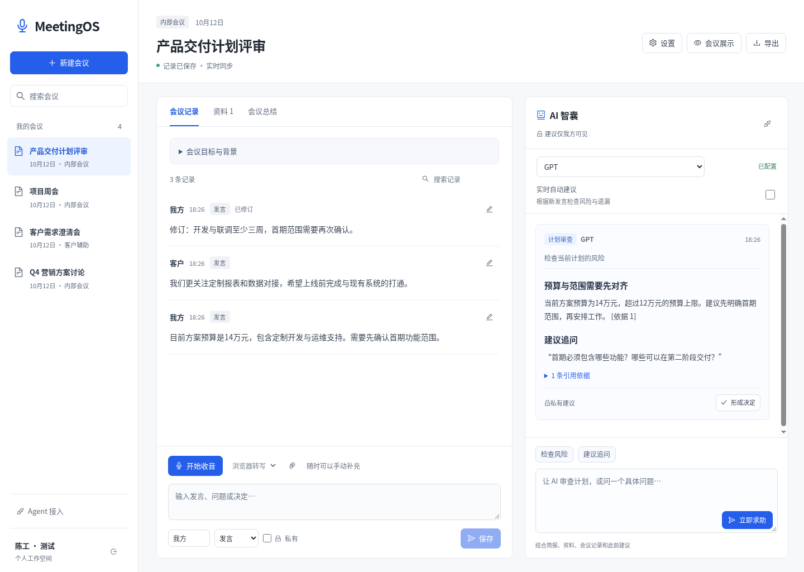
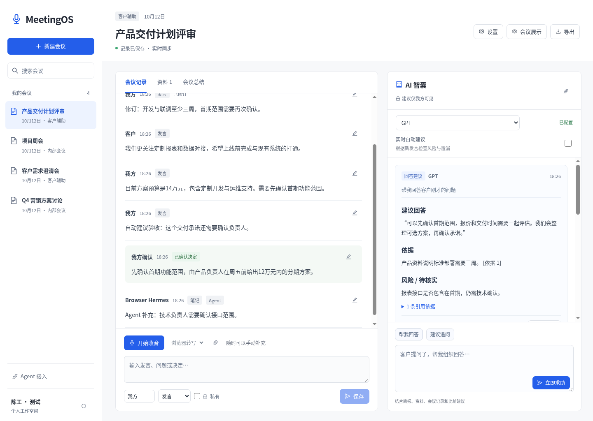

# 第一版开发验证记录

2026-10-12。只在云开发工作区与隔离临时数据库中执行，没有连接生产SSH、部署网站或操作其他服务器项目。

## 已通过

| 检查 | 结果 | 范围与证据 |
| --- | --- | --- |
| 冻结安装 | 通过 | Node24.19/npm11.9，`npm ci --ignore-scripts --no-audit --no-fund`，未改变依赖版本和完整性数据；锁文件只增加Node最低版本元数据 |
| TypeScript与生产构建 | 通过 | `npm run build`；当前JS约260KB、gzip82KB，CSS约20KB；输出out不提交 |
| 平台测试 | 22/22 | `npm test`，5个存储、14个API、3个资料边界；`evidence/implementation-20261012/platform-test-results.txt` |
| Lint | 通过 | `npm run lint`，当前平台/客户端与启动脚本，无警告/错误 |
| Chromium交互 | 19/19 | 1440×1024、390×844、768×1024；`browser-results.json`，未捕获JS/非预期控制台错误0 |
| 当前实例启动 | 通过 | 构建静态页+Node/API、Vite+API两种方式；健康、主页、JS、匿名401；Vite注册Cookie及Origin代理通过 |
| 云代理下Node HTTPS | 通过 | `NODE_USE_ENV_PROXY=1`读取允许的官方FluentUI源码200，TLS未禁用；不是模型质量测试 |
| 历史备份 | 通过 | 原服务器91个、本地205个文件与原SHA256完全一致，`snapshot-validation.json` |
| 视觉/交互QA | passed | 根目录`design-qa.md`，7张实际截图、两组局部对照、小字对比度与真实平台字体证据 |

GitHub Actions检查流程已加入，只跑安装/测试/lint/build，不执行部署或SSH。远端结果应以该工作流实际状态为准，不能把本地通过写成远端已通过。

## 平台测试具体覆盖

- 251条记录完整保存、分页、同ID重试幂等、不同内容拒绝；纯转写重新打开数据库仍保留。
- 修订版本冲突、原文保留、新文本进入导出和模型上下文。
- Cookie登录、跨站写入拒绝、账号隔离、生产注册默认关闭、邀请码与Secure属性。
- Agent作用域/会议边界、到期、撤销关闭流、撤销中止在途推理；授权最长90天不会被Node定时器溢出误取消。
- 共享转私有即时移除，客户API/变化回放/导出不泄露私有文本；客户返回不包含旧原文/私有引用元数据。
- 资料原件保存/下载、内容去重、DOCX/PPTX文字顺序、跳过媒体、解压量/条目上限；异常PDF数字数组不阻塞解析。
- 模型真正收到简报/资料/修订/先前建议；有效引用来自实际模型输出。
- 流式回复、错误明确、不写伪建议；总结版本缓存、修改后失效、私有总结不经缓存泄露。
- 自动建议由新发言触发并读取资料；人工请求优先取消自动分析。
- 有鉴权WebSocket、手动发言人标签、同ID转写不重复，与网页相同数据库。
- 模型输入超160000字符明确拒绝，原始长记录仍保存。

## 浏览器证据





其他截图：Agent权限设置、客户共享展示、手机记录/智囊和确认决定后的桌面。截图里的陈工、客户、会议和回答都是合成验收数据，模型由本地受控网关生成，令牌/密码没有收集到DOM证据或截图中。

## 如何复现受控浏览器检查

平台本身只需Node/npm；此项另需Python Playwright和系统Chromium。

```bash
npm run build
PORT=3171 node scripts/browser-fixture.mjs
```

另一终端启动自己的隔离Chromium（仅本地验收）：

```bash
chromium --headless --no-sandbox --disable-dev-shm-usage \
  --remote-debugging-address=127.0.0.1 --remote-debugging-port=9235 \
  --user-data-dir=/tmp/meetingos-dev-chromium about:blank
```

然后执行：

```bash
MEETINGOS_TEST_URL=http://127.0.0.1:3171 \
MEETINGOS_TEST_CDP=http://127.0.0.1:9235 \
python3 scripts/browser-smoke.py
```

脚本写入合成测试账号/会议。应使用其专用临时数据库和浏览器上下文，不指向生产；只关闭自己启动的进程。运行前清理该专用浏览器测试账号Cookie即可，不能删除其他浏览器会话。

## 未验证与第一版边界

真实模型凭据未提供；没有测试国外模型可达性、推理质量、延迟、价格或服务商支持的具体型号。历史模型默认ID保留可配置入口，界面用GPT/Claude名称与“已配置”避免把版本标签当成功调用证明。

真实语音识别、云端ASR结果、系统音频、说话人自动识别、现场噪音和手机键盘遮挡尚未验收。本轮只走了麦克风拒绝及协议/标签链路。浏览器Web Speech可能使用厂商网络服务。

当前按账号隔离，组织成员共享、自动Agent存储镜像、完整MCP/OAuth、OCR、超长上下文检索、离线队列、音频归档和旧数据迁移未实现。PDF只做基础文本抽取，常见压缩/特殊字体文件可能需要转TXT。

## 云环境配置

已保存新的根目录安装/启动草稿和三个可选个人凭据要求，保留既有仓库设置和域名。新增凭据目标为`api.linkharbor.ai`、`api.deepseek.com`、`dashscope.aliyuncs.com`；商业UI调查域名也仍在此前草稿中。

保存不等于应用或发布。需要在云开发环境设置审核、保存并发布后，才会用于新环境。当前验证仅说明此实例运行与测试通过，未宣称新任务恢复或生产网站发布；SSH仍暂停。
