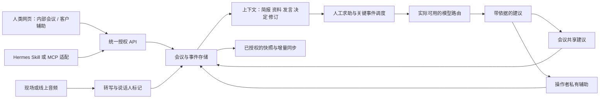

# MeetingOS 功能实测与改进报告

2026-10-11 · 评估对象：`https://meeting.weispace.cloud/`

> 2026-10-12 已按最初产品目标重新测试恢复的本地可编辑版本，包含实际页面、23 张截图和隔离接口验证，见 [重新测试报告](product-retest-20261012.md)。本文件保留原部署版证据，两份版本的结论不要混用。

**本报告包含线上接口实测、部署前端构建分析、已取回后端的源码审查和隔离环境恢复验证。后续已恢复并构建本地可编辑工程，但它与线上版本不同步，见 [源码恢复报告](source-recovery.md)。尚未完成截图、浏览器操作或真实音频测试，不能称为完整 UI 视觉审计或全流程验收。以下产品结论仍以服务器部署版本的证据为依据。**

## 1. 当前结论

网站已有“会前上传资料 → 会议转写 → AI 发言/点评 → 总结”的产品骨架。DeepSeek 驱动的角色和实时点评能产生有内容的回复；它不是单纯的静态展示页。

但你提出的两个核心目标，目前都还没有达到可依赖的程度：

- **会议中的 AI 成员：部分实现。** 手动发言、自动建议、转写保存与资料解析都有接口。本次 GPT-5.5 和 Claude 发言返回本地兜底文案，未完成真实上下文分析；DeepSeek 驱动的“芒格”能读附件，却没有核对出已经写在会议简报中的预算和工期。关键链路存在模型降级与上下文缺口。
- **客户会议中的私有智囊：具备部分基础能力，专门的产品流程尚未验证。** 可以上传背景、输入实时转写、获取建议。但部署前端没有独立的客户辅助模式、我方/客户的明确发言区分、私有建议通道、明确的即时问答入口或谈判约束表。不能把“有实时点评”直接等同于“可以可靠地陪你谈客户”。
- **人类使用：基础功能入口存在，会议恢复与数据可靠性不足。** 创建会议、上传资料和请求发言可通过接口工作；前端缺少会议列表/恢复入口，重复转写会重复保存，多项人工标记只在组件状态中保存。
- **外部 Agent 使用：可以通过现有 HTTP 接口操作，当前主服务没有受控授权接入。** 我在不提供网站登录、Cookie 或业务令牌的情况下完成了创建、读取、上传与发言请求。已取回的主服务没有登录、作用域令牌、会议归属或权限检查，也没有 Hermes Skill/MCP 实现。公开接口可调用不等于完成了有授权、可撤销的 Agent 接入。

最值得优先投入的是实际模型可用性、完整会议上下文、数据恢复和两种场景的明确交互。继续扩大名人角色库不能直接补齐这些缺口。

## 2. 证据范围与检查结果

本次只访问了 MeetingOS 域名。未进入服务器，未读取、修改或重启同服务器的其他网站。未修改线上应用代码，也没有发送邮件。

仅创建了一个合成测试会议 `7d3dba5d`，标题为“审计测试-20261011-仅合成数据-可删除”。会议内不含真实客户资料。删除该记录的请求返回 404，因此记录仍保留，待取得源码后确认支持的清理方式。

| 编号 | 检查 | 结果与含义 |
|---|---|---|
| E01 | 首页与部署 JS/CSS | 获取成功，标题“AI大咖会议私董会”；未取得浏览器截图 |
| E02 | `GET /api/roles` | 返回 25 个角色：23 个配置为 DeepSeek，2 个配置为 Linkharbor 路由下的 GPT/Claude；配置名称不代表模型调用已成功 |
| E03 | 创建并读取合成会议 | 无业务认证请求获得 HTTP 200，会议字段可回读；未证明重启后仍能恢复 |
| E04 | Markdown 上传与解析 | 返回解析文本，准确保留附件约束与校验码 |
| E05 | 转写保存与重复提交 | 3 条不同转写加 1 次相同 ID 重试，回读得到 4 条；幂等性失败 |
| E06 | GPT-5.5 手动与自动建议 | 返回“本地兜底模式”通用文案，没有核对预算、工期和部署要求；HTTP 200/SSE 流不能算 AI 分析通过 |
| E07 | Claude 手动发言 | 返回“本地兜底模式”通用文案；本次未验证到正常 Claude 分析 |
| E08 | 芒格/DeepSeek 手动发言 | 准确指出附件的离线部署要求与 SaaS 方案冲突，复述附件校验码；未复述简报校验码，并明确说看不到简报预算/工期基准 |
| E09 | 独立实时点评接口 | `ok:true`，模型字段为 DeepSeek，输出风险提示；该条点评没有出现在随后读取的会议点评列表中 |
| E10 | 智能纪要整理接口 | 原始字段与补齐前端字段的两次请求均 `ok:false, degraded:true`，提示整理服务暂不可用，保留原文 |
| E11 | 思维导图接口 | `ok:true`，输出与合成讨论对应的议题、待拍板方案与核查要求 |
| E12 | 总结接口与数据格式 | 服务器转写缺少 `type`，使用该数据时总结大部分为“会议未涉及”；只补 `type:speech` 即恢复人类议题总结，再合并 AI 意见后能总结角色观点 |
| E13 | 会议列表与删除 | `GET /api/meetings`、测试会议的 OPTIONS 与 DELETE 返回 404；只说明这些具体路由/方法未提供对应能力，不代表后端所有管理功能都不存在 |

证据文件：

- [完整接口请求结果](evidence/api-validation.json)：26 次请求，含合成数据与实际返回。
- [线上部署构建代码（格式化）](evidence/deployed-bundle.pretty.js)：用于定位前端逻辑，**不是从服务器同步来的完整项目源码**。
- [角色配置](evidence/roles.json)、[首页](evidence/home.html)、[样式](evidence/deployed-style.css)。

没有把 HTTP 200 当作功能通过。回复内容、`ok`、`degraded`、兜底提示和回读结果分别检查。

## 3. 两个核心场景的实测

### 3.1 拍板之前，AI 能否指出方案的问题？

我设置了三个相互独立的信息来源：

| 来源 | 合成内容 |
|---|---|
| 会前简报 | 预算最多 3 万元、工期最多 10 天、1 位工程师；校验码“蓝桥47” |
| 上传附件 | 客户要求离线私有化部署、数据不出内网，不接受公网 SaaS；校验码“银杏83” |
| 会中讨论 | 准备拍板 8 万元、4 周、公网 SaaS，明天分配工作；要求 AI 立即核对约束 |

合格的输出应在确认任务前指出三个冲突，并能复述两个校验码来证明读取了两个资料来源。

**GPT 与 Claude 未通过。** 实际输出是“先小步快跑验证假设”或“定义最小可行闭环”等兜底文案，没有核对任何一个具体冲突。这次没有验证到正常模型调用；是凭据、模型路由、网络还是调用失败导致，必须检查服务器配置和日志后才能定位。

**DeepSeek 角色部分通过。** 芒格说：“先别拍板……附件明确客户要求离线私有化部署……拟拍板方案却是公网SaaS。”附件事实与校验码都正确。但它同时说：“报价8万、工期4周是否与简报冲突，我没看到简报中的预算与工期基准。”这些基准在创建会议时已提交且仍保存在会议对象里。

源码和隔离请求捕获进一步确认了原因：`board-service.mjs` 的 `speakForMeeting` 只读取转写、最近发言和上传资料，没有读取会议简报。合成测试中，最终模型请求包含资料与发言校验词，不包含只放在简报里的校验词。因此简报虽保存成功，仍没有进入角色的分析上下文。

**自动建议也只部分成立。** 保存转写之后，会议点评列表中出现了 `trigger:auto` 的 GPT 兜底建议。这证明服务器有自动建议路径；本次建议没有实际帮助。前端另有自动发言开关和独立周期点评，尚未完成浏览器层的时机验证。

### 3.2 客户会议中，AI 能否成为私有智囊？

现有附件读取能力可以承接客户背景，这是可保留的基础。但本次尚未完成真实客户提问、音频转写和人类查看建议的完整流程。

从部署代码可以确认的缺口：

1. 首页定位和主操作围绕“私董会”“参会大咖”“让其表态”，没有专门的客户辅助任务入口。
2. 人类发言在前端统一归到“麦克风”，可统一改名；未看到将“客户问题”与“我方承诺”分别标记的标准字段和流程。谈判辅助需要知道是谁说了什么。
3. AI 意见、实时反馈与会议发言在同一套会议界面中组合展示；未看到明确的公开/私有输出分离设置。
4. 周期点评不等于即时回答客户问题。前端周期点评间隔为 150 秒，另有话题变化触发和至少 60 秒冷却，不能保证客户每次提问都及时得到答复。
5. 独立点评请求提交的是讲话文本、会议标题、话题、锚点和既有点评；后端直接将这些字段交给 `liveCommentary`，没有另行读取会议简报或附件，也没有将这一路结果保存到会议点评数组。
6. 页面主入口是“发言”，未看到专门的“给我一句可直接回答客户的话”“这个技术问题如何解释”“下一步该追问什么”流程。

建议为客户辅助单独设计：**一句可说的话 → 依据 → 尚不确定的信息 → 建议追问**。长篇推理放在展开区。私有建议不应自动写进公开纪要或对外输出；音频采集、会议记录与数据使用仍需遵循参与者知情与组织规则。

## 4. UI、交互与易用性分析

以下是部署代码确认的页面结构和交互设计问题。未取得截图，因此不评价实际渲染的美观程度，不声称完成对比度、布局或移动端视觉验证。

### 4.1 页面路径与状态

| 步骤 | 页面/动作 | 健康情况 |
|---|---|---|
| 1 | 会前准备：标题、简报、角色、资料 | 结构明确；默认不选角色，未选时进入按钮禁用；尚未浏览器实测 |
| 2 | 创建会议与解析资料 | 合成 Markdown 的接口路径通过；其他文件格式、超时与页面反馈未实测 |
| 3 | 开始收音与转写 | 有浏览器语音和阿里云实时入口；麦克风采集、准确性、远端音频与延迟未验证 |
| 4 | 发言区与实时反馈 | 有转写、建议、锚点、搜索、编辑、标记；模型和存储问题已实测 |
| 5 | 大咖发言与自动开关 | 手动接口可用，但 GPT/Claude 降级；自动交互时机未浏览器验证 |
| 6 | 智能纪要与导图 | 纪要整理失败，导图接口通过；切页和可视化布局未验证 |
| 7 | 结束会议与总结 | 总结服务有能力，但当前数据格式与 AI 意见汇总路径有缺口；未实测页面点击 |
| 8 | 邮箱发送 | 有预览、确认与状态逻辑；成功文案写着“邮件已发送（演示）”；未调用发送接口 |
| 9 | 返回、刷新与恢复 | 前端没有会议列表、URL 会议恢复或浏览器持久化入口；真实刷新尚未验证 |

### 4.2 可以保留的设计

- 会前资料先解析再进入会议，支持 `.txt/.md/.pdf/.docx` 的入口，并有大小限制与解析超时提示。实际只验证了 Markdown。
- 发言支持 SSE 流式更新；原始转写有 HTTP 保存路径，语音/点评失败时部分逻辑会保留原文。
- 实时反馈包含风险、澄清、建议、高亮类型，并有回到原始发言的锚点设计。
- 会中搜索能覆盖发言、纪要、导图、点评，符合“快速找回讨论依据”的需要。
- 总结设计了主题、议题、决定、行动项、观点与整体脉络；补齐数据后接口能产出对应内容。
- 页签有部分 ARIA 属性，错误区域有部分 `role:alert`；这只是实现基础，不代表无障碍整体通过。

### 4.3 最影响使用的改进

**把会议任务放到角色选择之前。** 目前开始会议要先从 25 个角色中选择至少一个，主页主要解释名人私董会。用户通常知道“我要评审方案/我要见客户”，未必知道该选哪个人物。建议默认提供“内部讨论”和“客户辅助”，每种模式先给一组能实际调用的助手：风险审查、技术顾问、行动整理。高级用户再编辑人物风格。

**模型可用性要能看见。** 角色卡的“旁听中”“正在发言”不足以说明模型是否正常。GPT/Claude 的兜底内容仍被作为发言与意见保存，后续总结还会把这类文案当作其观点。应明确显示调用失败、降级原因类别、实际提供方和重试/切换入口。兜底提示不应进入正式决定的依据。

**合并或解释两套自动机制。** 顶部有“自动发言”，反馈区另有“点评中/已静音”，两者代码路径和触发条件不同。普通用户难以判断关掉哪个才会停止建议。建议统一成“关闭 / 只在关键问题时提醒 / 定期审查”，展开设置再配置角色和频率。

**增加直接解决问题的按钮。** 将“💬 发言”补充为“审查当前方案”“回答刚才的问题”“总结待确认事项”。角色只是回答方式，用户目标应是操作入口。

**恢复会议应成为主路径。** 当前顶层页面状态在内存中，默认回到准备页；没有会议列表、通过 URL 找回会议或保存最近会议的逻辑。即使服务器还保存数据，用户也缺少找回入口。应增加会议工作区、固定会议地址、自动保存状态与恢复提示。

**让编辑、标记和收藏成为真实数据。** 前端的改名、标签、人工修订、高亮、人工点评、收藏与忽略主要使用组件状态，未看到对应保存请求。离开页面或重新挂载存在丢失风险；人工修订也没有写回原始转写，后续模型和总结可能继续读取旧内容。应提供版本化编辑接口和保存反馈。

**把简报和资料状态放在会中可检查的位置。** 显示“本次 AI 使用了哪些资料、哪些未解析、采用哪个版本”。用户不能仅从上传成功推断模型已读取。本次简报核对失败正说明这一点。

### 4.4 无障碍与响应式检查边界

部署代码中的角色选择卡使用可点击 `div`，未看到键盘操作或焦点属性；“自动发言”使用点击 `label`，而独立点评开关的 checkbox 设置为 `display:none`。这些存在键盘可操作性风险，应改为原生按钮/可聚焦表单控件，保留可见焦点。

页面标题与简报主要通过标题和占位文字说明，需检查是否有正式关联的表单标签。导图折叠节点有点击和部分 `role:button`，未看到完整键盘操作。

CSS 有深色玻璃效果、角色背景图和 720px 窄屏规则。真实对比度、滚动、触控目标、缩放、屏幕阅读器和动态提示需要截图及浏览器操作后评估；当前不做合规结论。

## 5. 数据存储与可靠性

### 5.1 已确认和未确认的边界

| 项目 | 当前证据 |
|---|---|
| 服务端会议数据 | 可以跨请求回读会议、转写、附件和角色意见 |
| 数据库/磁盘持久化 | 主服务使用 `server/data/meetings.json` 全量 JSON 落盘；隔离恢复验证中，会议、转写和意见在本地服务重启后仍可读取；没有重启生产服务 |
| 用户隔离 | 主服务没有会议所有者/工作区字段和授权检查；REST 与 WebSocket 均可匿名访问；源码中的 SQLite 培训数据模块没有被当前主服务导入 |
| Agent 个人存储 | 未发现或验证导出到个人 Hermes/其他 Agent 的目的端与同步协议 |
| 客户端标记 | 多项状态只在 React 组件内存中维护，缺少已识别的保存接口 |
| 转写重试 | 相同 ID 被重复保存，已实测 |
| 独立点评持久化 | 本次接口返回的点评未出现在该会议点评列表中；前端也在本地列表保存该结果 |
| 多人同时操作/断线恢复 | 未验证 |

### 5.2 总结的数据契约问题

服务器返回的转写条目字段是 `id/text/final/ts`，本次没有 `type`。总结页重新读取会议，再把 `meeting.transcript` 交给 `Jt`，该函数沿用 `entry.type`，不会补成 `speech`。同时，AI 意见存储在单独的 `opinions` 数组，而该生成入口仅使用 `meeting.transcript`。

实测中，把服务器转写直接交给总结服务，主要内容被写成“会议未涉及”。单变量对照只给同一份人类转写补上 `type:speech`，便能正确总结讨论和待核查事项；因未合并意见，角色观点仍写成未见明确观点。再将意见补成 `type:opinion` 并合并后，服务正确总结了讨论、冲突、行动和三个角色的意见。

这是当前总结链路的数据契约缺口，证据来自代码与接口；尚未通过浏览器复现最终页面。修复应统一转写/意见类型，避免总结页和其他 Agent 各自猜测数据格式，并为有效但为空的总结增加校验。

### 5.3 推荐早期存储方式

建议早期继续由服务器保存完整会议作为默认依据，不要求同事自带 Agent；通过内部工作区与成员身份区分访问和操作来源。已有 JSON 存储可短期用于内部验证，但更改时应增加原子写、失败反馈和备份；随后评估 SQLite 等更可维护的存储，避免每次修改重写全部会议。

会议应保留原文、人工修订版本、资料解析版本、模型建议、采纳决定和任务。转写 ID/事件 ID 唯一，重试不能制造重复记录。同步到个人 Agent 时采用已授权的会议快照和增量事件，并记录版本、目的端、重试与完成状态。

撤销授权应停止未来同步；已经导出的个人副本能否删除必须明示，不能承诺通过撤销令牌追回外部系统已经保存的内容。

## 6. 是否同时支持人类和 Agent？

**目前是“有人类页面，也有可调用接口”，还未验证到“有权限、可恢复、语义一致的双入口”。**

| 能力 | 人类侧现状 | Agent 侧现状/建议 |
|---|---|---|
| 创建/读会议 | 创建入口有；列表/恢复缺少已识别入口 | REST 创建/读取实测可用；补稳定列表、过滤和分页 |
| 读资料/转写 | 会前上传、会中展示 | 接口可读写合成数据；明确字段、版本和访问范围 |
| 请求 AI 建议 | 角色发言/自动点评 | `/speak` 可被脚本调用；增加标准任务接口，明确模型失败与降级 |
| 实时变化 | WebSocket、SSE 路径存在 | 尚未验证可恢复的 Agent 订阅、游标或断线补拉 |
| 授权 | 未看到登录/内部成员管理入口 | 未验证作用域令牌、过期、撤销和审计归属 |
| 修改与标记 | 部分只在客户端状态中 | 增加共享的版本化写接口与冲突反馈 |
| 导出/同步 | 文本导出入口有；实际下载未测试 | 提供 JSON/Markdown 快照和事件增量；目的端显式授权 |
| Hermes 接入 | 无已识别接入入口 | 先提供 REST + 事件说明 + Skill；若用户的 Hermes 支持 MCP，再增加适配 |

推荐的早期授权粒度：会议读取、资料读取、建议写入、任务写入、数据导出分别授权。人类账号和 Agent 令牌都经过同一个后端权限检查。不要用“用户知道会议 ID”代替权限。

早期不必开放公众注册，但公网部署的内部工具至少应有内部登录/网关访问控制。当前测试的匿名创建、读取和模型触发是实际观察到的行为；是否已有另外的网关限制需检查站点配置。

一个 Hermes Skill 应当说明：如何授权、哪些会议可读、如何追踪事件、如何请求建议、写操作的幂等键、错误码与撤销方式。Skill 文档不能替代后端 API 和权限实现。

## 7. 建议的产品结构

推荐默认带内置 AI，个人 Agent 可选择加入。一次会议的数据与上下文服务应同时支撑页面和 Agent，减少现在多个接口各自拼资料的情况。

这是建议架构，不是当前后端实现的声明。

**内部会议模式：** 会前选议题/资料 → 开始会议 → AI 捕捉疑问、矛盾和即将拍板的决定 → 人工选择采纳/忽略 → 确认决策和责任人 → 形成任务与总结。

**客户辅助模式：** 会前配置客户事实、产品能力、价格/交付边界 → 标明客户/我方讲话 → 操作者得到私有短答和追问 → 必要时展开技术解释和依据 → 会后分别导出对外纪要与内部复盘。

AI 默认提供建议，不把未经确认的推测直接转成已承诺事项。实时调度优先响应提问、约束冲突和拍板动作；定时器作为补充。普通更新可用较快模型，重要方案审查可以异步调用更强模型，避免每段话让所有角色发言。

## 8. 开发优先级与验收

| 优先级 | 改进 | 验收标准 |
|---|---|---|
| P0 | GPT/Claude 路由及可用状态 | 实际输出能回答合成问题；失败明确标记，兜底不冒充成功分析 |
| P0 | 完整会议上下文 | 同时识别 3 万元/10 天/离线部署三项约束，复述两个资料校验码；修订后使用新版本 |
| P0 | 总结数据契约 | 使用正常页面/接口保存的会议即可总结；纳入角色意见，非空会议不产生空泛成功结果 |
| P0 | 转写幂等与点评保存 | 同 ID 重试仍仅 1 条；独立点评回读得到；断线重试不重复、不遗漏 |
| P0 | 内部访问控制 | 未授权请求被拒绝；内部成员与 Agent 对自己获授权会议可用 |
| P1 | 会议列表、固定地址与恢复 | 刷新或重新登录后恢复会议；标记/修订/收藏仍存在 |
| P1 | 两种模式与直接求助 | 无需理解名人角色即可开始；客户短答有依据且只进入私有区域 |
| P1 | 真实音频与说话人验证 | 现场收音、远端音频分别验证；明确标记客户与我方；可见采集/保存故障 |
| P1 | Hermes 授权接入 | Skill 完成授权、读资料、订阅变化、请求建议、撤销；与页面看到同一版本数据 |
| P2 | 个人 Agent 同步与 MCP | 明确接收端协议；断网恢复、去重、冲突与撤销行为通过实测 |
| P2 | 多模型深度审查 | 根据实际响应时延与质量选模型；保留费用与失败记录，不要求所有角色同时响应 |

推荐第一轮开发范围是 P0 加会议恢复、直接求助和客户私有建议。完成这些后再扩展复杂角色系统、多人实时协作和跨设备同步。

时延验收需要单独测量转写最终化、请求到首条有用建议、完整回复三个阶段，并在多次测试后看慢请求。此次一次完整请求耗时：GPT 兜底约 1.35 秒、Claude 兜底约 2.46 秒、DeepSeek 角色约 19 秒、实时点评约 9 秒、导图约 15 秒、补齐数据的总结约 42 秒。它们不是首 token 时延，也不足以计算统计分位数；兜底快不能代表智能辅助快。

## 9. 服务器备份、恢复与 SSH

已确认目标为 `101.35.232.194:22`（`test.fdespace.cn`）。会议域名对应 `/etc/nginx/conf.d/aiboard.conf`，代理到 `127.0.0.1:3001`；用户查询确认 Node 工作目录为 `/opt/aiboard`。

已收到并检查用户导出的 6.4MB 归档，保存后端源码、角色资料、部署文件、依赖清单和锁文件、当前前端发布版本。静态角色库被最初的业务数据排除规则一并漏掉，用户已回传原配置并补回。生产 `.env`、会议记录、上传资料、录音、日志与历史备份未导入。归档内应用文件保持原字节，未修改产品行为。备份来源与限制见 [备份说明](backup.md)。

服务器归档的前端 `out/` 与线上下载的 JS 字节一致，但归档没有 `src/`、前端开发入口、TypeScript/Vite 配置或 `scripts/dev.mjs`。随后从用户电脑恢复了这些开发文件，并通过 TypeScript/Vite 构建与隔离启动，单独保存为本地快照。该工程有 22 个角色，服务器版有 25 个；后端和构建产物也有差异，不能宣称完整重现了线上最新版。详见 [源码恢复报告](source-recovery.md)。

以锁文件安装生产依赖成功。补回静态配置后，在隔离环境验证了健康接口、当前页面、25 个角色、资料解析、转写/意见保存、WebSocket 转写、Markdown 导出与本地重启恢复。[恢复验证结果](evidence/restored-runtime-validation.json) 包含正常行为、确认缺陷和未配置模型时的降级结果，不是“全部产品功能通过”。原始归档缺少角色库时会启动失败，补回后可以启动。

用户电脑上 `ssh ubuntu@101.35.232.194 -p 22` 已成功登录；服务器云防火墙也已允许 TCP 22。当前云任务的直连仍被拒绝，代理 CONNECT 后未收到 SSH 握手。现有工具没有切换执行机器或应用/发布云网络配置的能力。后续可以在本地执行环境复用已验证连接；仓库另加入手动 GitHub Actions SSH 检查作为部署候选路径，详见 [SSH 设置说明](../deploy/SSH.md)。该工作流仅做登录和文件读取检查，需要配置专用密钥、可信主机公钥并实际运行；当前尚未运行，不能据此宣称云任务或 CI 已连通。

本次未部署新版，未重启生产会议服务，未操作服务器其他项目。

## 10. 后端源码确认的原因与优先级

| 优先级 | 问题与源码依据 | 对核心场景的影响 | 建议 |
|---|---|---|---|
| P0 | `llm-router.mjs` 遇到调用失败直接转本地兜底，未向调用方报告结构化失败类别 | 配置了国外模型仍可能只得到通用文案 | 区分模型真实成功、调用失败和降级；记录无密钥的错误类别与耗时，显示实际路由 |
| P0 | `board-service.mjs` 的角色发言只使用资料、转写和最近发言，遗漏简报 | 预算、客户底线等会前事实缺失 | 建立统一上下文，包含简报、约束、资料、发言、决定与待核查项 |
| P0 | `meeting-service.mjs` 保存 `id/text/final/ts`；`transcript-service.mjs` 总结仅接受 `type:speech/opinion` | 已有逐字稿被总结过滤掉，AI 意见另存也未合并 | 统一事件类型，由服务端按会议读取完整总结输入 |
| P0 | 主服务没有认证、会议归属和授权检查 | 内部同事与外部 Agent 没有受控访问边界，客户辅助数据也无隔离 | 先加内部工作区授权；人类和 Agent 共用同一权限判断 |
| P1 | 重复客户端转写 ID 直接 push，没有去重 | 重连/重试重复记录和分析 | ID 唯一约束与幂等写入 |
| P1 | JSON 全量同步写盘，错误被吞掉；只对转写做 1 秒合并写 | 长会议阻塞，磁盘问题可能被当作成功 | 原子写/事务、明确写入失败反馈、备份与恢复检查 |
| P1 | 所谓全部转写实际为最近约 24000 字符窗口 | 早期客户事实和承诺可能从上下文消失 | 保留原文，配合滚动摘要、约束表和有出处的检索 |
| P1 | 独立 `liveCommentary` 请求不补会前上下文，也不持久化其返回值 | 两套点评上下文与恢复能力不一致 | 共用上下文和事件存储，统一开关与触发说明 |
| P1 | 大咖点评有 60 秒门控、4.5 分钟间隔、单会议 20 条上限；前端另有 150 秒采集 | 不能保证每次客户提问都即时得到帮助 | 按问题、风险和人类点击触发，分别设延迟与频率目标 |
| P1 | 总结缓存只使用级别、条数、末条 ID；同 ID 内容修改不影响键 | 人工修订后可能复用旧总结 | 用内容/事件版本作为缓存依据 |
| P2 | 逐字稿邮件附件同样按 `type` 过滤，后端真实依赖 agently-cli；前端成功文案写“演示” | 发送承诺与实际附件可能不一致 | 统一输入契约并验证邮件依赖；成功状态以真实结果为准 |

上下文请求捕获只使用合成校验词和本地模拟响应，未调用外部模型。结果为：资料进入角色请求、转写进入角色请求、简报没有进入；未带类型的发言被总结提示过滤，补上类型后保留。见 [上下文检查](evidence/context-validation.json)。源码分析没有改动上述行为。

## 11. 剩余验收

1. 已恢复可编辑、可构建的本地工程；仍需对齐服务器后续修改，并确认结构化纪要、来源条目等接口契约，取得与线上版本对应的完整开发基线。
2. 采集主要页面截图，执行人类的准备、会中提问、私密建议、结束与恢复流程。
3. 使用授权模型与真实音频验证国外模型、转写、即时回答的质量和延迟；本次未读取生产密钥或调用邮件发送。
4. 验证多人操作、断线补拉、权限隔离与个人 Agent 同步。
5. 用户已暂缓 SSH 设置；待恢复部署工作后，在选定执行环境完成密钥配置、主机验证和实际连接检查，再准备只针对会议服务的发布与回滚。

现有证据可以支持首轮产品改进决策；完整视觉与客户会议体验仍需补充上述验证。
