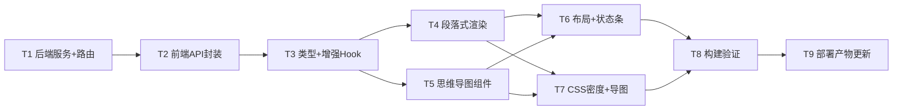

# 设计文档 · 实时转录增强（段落化 + LLM 整理 + 思维导图）

> 架构师：高见远（software-architect）
> 基于 PRD `docs/prd-live-transcript-mindmap.md` 与「已决议边界」产出。
> 技术栈：前端 React 19 + Vite 8 + TypeScript 6.0（strict）；后端 Node ESM（`server/*.mjs`）；样式沿用项目既有 CSS 变量体系（不引入 MUI / 新 UI 框架）。
> 本文件只包含设计，**不含实现代码**。

---

## Part A：系统设计

### 1. 实现方案 + 框架选型

#### 1.1 难点分析
1. **复用 DeepSeek V4 Pro 做「批量（非流式）」整理/导图**：既有 `streamOpenAiCompatible` 是 `stream:true` 的增量生成器，需要把它「收集全文」后作为一次性结果返回。需加超时（`AbortController`）防止卡死。
2. **前端定时器与会议生命周期绑定**：严格 60s 整理 / 5min 导图，进会议才开始计时、离开（组件卸载）必须清定时器与中止在途请求，且 interval 回调不能读到陈旧的 `entries`。
3. **段落式聚合渲染**：现有 `TranscriptPanel` 逐行 `.line` 渲染，需改为按「时间停顿」聚合的段落块，interim 仅附在最新段末。
4. **思维导图 JSON 约束**：LLM 输出可能超深/超宽/超长标题，后端必须归一化（深度≤4、每层≤8、标题≤24 字）。
5. **零新增依赖**：可视化自研轻量递归树（HTML/CSS + 折叠），不引 markmap 等。

#### 1.2 框架 / 库选型（沿用现有栈，0 新增）
| 关注点 | 选型 | 理由 |
| --- | --- | --- |
| 前端 UI | React 19 + 既有 CSS 变量 | 不引入 MUI / 新框架（边界 5） |
| 前端状态 | 新增 `useTranscriptEnhance` 自定义 Hook | 把「60s/5min 定时器 + 增强状态」从 `useBoard` 解耦，保持 `useBoard` 不变 |
| 后端 LLM | 复用 `server/llm-router.mjs` 的 `deepseekKey()` + `streamOpenAiCompatible` | 密钥与环境读取集中，符合既有范式 |
| 后端路由 | 复用 `server/api-server.mjs` 的 `router` + `readJsonBody` + `sendJson` | 新接口遵循同一范式，无状态、不入库 |
| 思维导图渲染 | 自研递归树（React 组件 + CSS 缩进/三角/连线） | 边界 5：不引 markmap；体积可控、离线可用 |
| 包管理 | **无新增 npm 包** | 见第 6 节 |

#### 1.3 两个新后端接口如何挂载
在 `server/api-server.mjs` 的 `router(req, res, url)` 内、既有 `/api/health` 之后新增两个独立 POST 路由：
- `POST /api/transcript/refine`
- `POST /api/transcript/mindmap`

它们**不绑定 meetingId、不读库、不写库**（边界 7/8），因此不进入现有的 `/api/meetings/:id/...` 分支，作为顶层 `/api/transcript/*` 直接处理。handler 内部 `import * as transcriptSvc from './transcript-service.mjs'` 并调用 `transcriptSvc.refine(...)` / `transcriptSvc.mindmap(...)`。

#### 1.4 前端新状态如何组织
新增独立 Hook `useTranscriptEnhance`（不在 `useBoard` 内改逻辑）：
- `BoardRoom` 调用 `useTranscriptEnhance({ entries })`，把钩子返回的状态透传给 `TranscriptPanel`（段落渲染 + 视图切换）与 `MindMap`（导图渲染），并在状态条上消费 `refining/lastRefineAt/refineError` 等。
- 钩子内部用 `entriesRef` 跟随最新 `entries`，`getRawText()` 始终基于最新数据，避免 interval 闭包陈旧（边界 7 的数据来源）。

---

### 2. 文件列表及相对路径（新建 + 修改）

| 文件 | 状态 | 职责 |
| --- | --- | --- |
| `server/transcript-service.mjs` | **新建** | 封装 `refine` / `mindmap` 的 LLM 调用（复用 `streamDeepSeek`）；`collectDeepSeek` 收集全文；`buildRefineMessages`/`buildMindmapMessages` 构造 prompt；`normalizeMindmap` 约束（深度≤4/每层≤8/标题≤24）；无状态、不入库。 |
| `server/llm-router.mjs` | 修改 | 新增导出 `streamDeepSeek({ messages, signal })`，集中 DeepSeek V4 Pro 的 baseUrl+key+model，供 transcript-service 复用（**不改动**既有 `streamLLM`）。 |
| `server/api-server.mjs` | 修改 | `router` 新增两个 POST 路由 `/api/transcript/refine`、`/api/transcript/mindmap`；各自带 `AbortController` 超时（25s/40s）；无论 LLM 成败均 `sendJson(res,200,...)`（失败也返回 200 + `ok:false` + 原稿/null + `degraded:true`）。不触碰大咖发言/转录落库链路。 |
| `src/lib/api.ts` | 修改 | 新增 `refineTranscript(rawText, signal?)`、`mindmapTranscript(rawText, signal?)`：指向两个新接口，带前端 `AbortController` 超时（30s/45s 安全网），解析为 `RefineResponse`/`MindmapResponse`。与既有风格一致。 |
| `src/hooks/useTranscriptEnhance.ts` | **新建** | 管 60s/5min 定时器与增强状态；挂载即启定时器、卸载/`active=false` 清定时器并中止在途请求；每个 tick 检查 `rawText` 为空则跳过；失败降级保留原稿、置错误态、不白屏。 |
| `src/components/TranscriptPanel.tsx` | 修改 | 由「逐行 `.line`」改为「段落式 `.para`」；按相邻 `ts` 停顿（>PAUSE_MS≈2.5s）聚合成段；`interim` 仅附最新段末（浅灰斜体「正在识别…」）；支持 `view: 'raw' | 'refined'` 切换显示原稿 / 整理版。 |
| `src/components/MindMap.tsx` | **新建** | 递归树渲染 `MindMapNode`；自研轻量 HTML/CSS+折叠；节点可展开/收起（P0 基础折叠 C2）；层级用缩进 + 连接线（CSS）表达；面板可滚动。 |
| `src/components/BoardRoom.tsx` | 修改 | 主区由「上下分栏」改为「左右分栏」（左转录 ~62% / 右导图 ~38%，PRD §5.1）；转录区顶部加状态条（整理中…/最近整理于 HH:MM/视图切换/失败提示）；右侧面板加导图状态（更新于 HH:MM/失败提示）+ `<MindMap>`。不改动 `BigShotBar` / `MicControls` 行为。 |
| `src/index.css` | 修改 | 转录区密度（`.para` 14px / 行距 1.45 / 段距 8px / `.interim-hint` 浅灰斜体）；左右分栏布局（`.transcript-col`/`.mindmap-col`/`.enhance-statusbar`）；思维导图样式（`.mindmap`/`.mm-node`/`.mm-children`/`.mm-caret`/`.mm-title`/层级缩进连线）。复用既有 CSS 变量。 |

> 说明：`server/llm-router.mjs` 在任务文件清单示例中未列出，但为干净复用 `streamOpenAiCompatible` 且不重复散落 `DEEPSEEK_BASE` 默认值，本设计新增一个 1 行的 `streamDeepSeek` 封装（仅导出、不动既有逻辑），故列为「修改」。

---

### 3. 数据结构与接口（类图 / JSON schema）

#### 3.1 共享类型（前端 `MindMapNode` 与后端返回一致）

```ts
// src/types.ts 追加（或放在 useTranscriptEnhance.ts 内导出）
export interface MindMapNode {
  title: string
  children?: MindMapNode[]
}
```

#### 3.2 `POST /api/transcript/refine`

请求体：
```ts
interface RefineRequest { rawText: string }
```

响应体（**始终 HTTP 200**）：
```ts
interface RefineResponse {
  ok: boolean
  refinedText: string   // 成功=润色后文本；失败=原稿 rawText
  model?: string        // 成功时：'deepseek-v4-pro'
  tookMs?: number       // 成功时：耗时
  error?: string        // 失败时：可读中文原因（绝不暴露密钥/堆栈）
  degraded?: boolean    // true=降级（保留原稿，前端状态条显「整理暂不可用」）
}
```

**为何采用「200 + `{ok:false, refinedText:原稿}`」而非 4xx/5xx？**
1. 前端**始终需要可显示内容**：无论成败都应拿到 `refinedText`（成功=润色版，失败=原稿），直接渲染，无需按 HTTP 状态码分支——契合边界 1「保留原稿、不白屏」。
2. 既有 `src/lib/api.ts` 的 `json<T>` 在 `!res.ok` 时**抛错**；若返回 5xx，每个调用方都须 `try/catch` 才能回退原稿，遗漏即白屏。返回 200 后调用方只判 `ok` 字段，降级路径是普通赋值，更健壮。
3. `api-server.mjs` 全局 `router` 的 catch 会回 500；而这两个接口在 handler 内部**自吞异常**并 `sendJson(200, {ok:false,...})`，确保即便 LLM 超时/限流/缺密钥，前端仍拿到合法载荷（降级 UI 由 P2-3 细化，策略本期已定）。

#### 3.3 `POST /api/transcript/mindmap`

请求体：
```ts
interface MindmapRequest { rawText: string }
```

响应体（**始终 HTTP 200**）：
```ts
interface MindmapResponse {
  ok: boolean
  root: MindMapNode | null   // 成功=根节点；失败=null
  tookMs?: number
  error?: string
  degraded?: boolean
}
```

#### 3.4 后端 `normalizeMindmap` 约束（落实边界 2）
- **深度 ≤ 4**：根为 depth 0；任意节点 `depth >= 4` 时丢弃其 `children`（叶子化）。
- **每层子节点 ≤ 8**：超出截断保留前 8；若确实被截断，可在末位追加一个 `title: '…（另有 N 项）'` 的提示节点（可选，默认直接截断）。
- **标题 ≤ 24 字**：超出截断为前 24 字 + `…`。
- 入参 `rawText` 为空或 LLM 返回非法 JSON → 直接 `ok:false, root:null, degraded:true`。

#### 3.5 前端 `useTranscriptEnhance` 暴露的状态形状

```ts
interface EnhanceState {
  rawText: string                                  // 当前累积原始转录（= speech 条目 join('\n')）
  refinedText: string | null                       // 最近一次整理结果（null=尚未成功）
  mindmap: MindMapNode | null                      // 最近一次导图（null=尚未成功）
  refining: boolean                                // 整理请求进行中
  mindmapping: boolean                             // 导图请求进行中
  lastRefineAt: number | null                     // 上次成功整理时间戳（ms）
  lastMindmapAt: number | null                    // 上次成功导图时间戳（ms）
  refineError: string | null                      // 整理降级原因（状态条显「整理暂不可用」）
  mindmapError: string | null                     // 导图降级原因（状态条显「导图暂不可用」）
}
// 钩子签名：
// useTranscriptEnhance({ entries, active?: boolean, refineIntervalMs?: number, mindmapIntervalMs?: number }): EnhanceState
```

> 注：`rawText / refinedText / mindmap / refining / mindmapping / lastRefineAt / lastMindmapAt` 为边界指定的核心字段；额外补 `refineError / mindmapError` 供状态条做降级提示（边界 1），属展示所需、非破坏变更。

#### 3.6 类图（Mermaid，详见 `class-diagram.mermaid`）

要点：
- `ApiServer` ──调用──▶ `TranscriptService`
- `UseTranscriptEnhance` ──调用──▶ `ApiClient`，并 ──持有──▶ `MindMapNode`
- `MindMap` ──渲染──▶ `MindMapNode`
- `BoardRoom` 组合 `UseTranscriptEnhance` / `MindMap` / `TranscriptPanel`

---

### 4. 程序调用流程（时序图，详见 `sequence-diagram.mermaid`）

覆盖三段：
1. **进会议 → 60s 定时器触发 refine → 后端 LLM → 前端更新**
2. **进会议 → 5min 定时器触发 mindmap → 更新**
3. **interim → final → 聚合段落**

要点：
- 定时器在 `useTranscriptEnhance` 挂载（进会议）时启动；每个 tick 先算 `rawText`，为空则跳过（边界 6）。
- refine/mindmap 均带 `AbortController` 超时（前端 30s/45s，后端 25s/40s）。
- 成功更新 `refinedText/lastRefineAt` 或 `mindmap/lastMindmapAt`；失败置 `refineError/mindmapError` 并保留上次结果（降级、不重试，下个周期再试）。
- `TranscriptionController.onInterim` → `useBoard.setInterim`；`onTranscript(final)` → `useBoard.addHuman` → 追加 speech `entry`；`TranscriptPanel` 按停顿聚合成段，interim 附最新段末。

---

### 5. 任务列表（有序、含依赖、按实现顺序）

> 共 9 个任务（落在 8–12 区间）。每个任务标注文件、依赖前序任务编号、优先级（P0=本期必做）。

| 任务 | 名称 | 文件 | 依赖 | 优先级 |
| --- | --- | --- | --- | --- |
| **T1** | 后端：transcript-service + llm-router 封装 + 2 个路由 | `server/transcript-service.mjs`(新)、`server/llm-router.mjs`(改)、`server/api-server.mjs`(改) | 无 | P0 |
| **T2** | 前端：API 封装（refine/mindmap 调用 + 超时） | `src/lib/api.ts`(改) | T1（契约已定） | P0 |
| **T3** | 前端：类型 + 增强 Hook（状态形状 + 60s/5min 定时器 + 清理） | `src/hooks/useTranscriptEnhance.ts`(新)、`src/types.ts`(改：加 `MindMapNode`) | T2（依赖 api 函数） | P0 |
| **T4** | 前端：段落式渲染（TranscriptPanel 改造） | `src/components/TranscriptPanel.tsx`(改) | T3（消费 refinedText/rawText/view） | P0 |
| **T5** | 前端：思维导图组件（递归树 + 基础折叠） | `src/components/MindMap.tsx`(新) | T3（消费 mindmap 状态） | P0 |
| **T6** | 前端：布局与状态条（BoardRoom 左右分栏 + 接入 Hook） | `src/components/BoardRoom.tsx`(改) | T3、T4、T5 | P0 |
| **T7** | 前端：CSS 密度与导图样式 | `src/index.css`(改) | T4、T5（类名已定） | P0 |
| **T8** | 构建验证（tsc 严格 + `npm run build` + 烟雾） | `package.json` 脚本复用；`out/` 产物校验 | T1–T7 | P0 |
| **T9** | 部署产物更新（重新生成 `out/` + 重启 aiboard.service；按需更新 tar 包） | `out/`、`deploy/`（若走 tar 包） | T8 | P0 |

依赖链（Mermaid，详见文末第 9 节 / 文件）：
`T1 → T2 → T3 → {T4, T5} → T6 → T7 → T8 → T9`（T4、T5 亦直接汇入 T7）。

---

### 6. 依赖包列表

**本期不新增任何 npm 包。**

- 前端：仅用 React（已装）+ 既有 CSS，思维导图自研递归树，不引 markmap。
- 后端：仅用 Node 内置 + 既有 `ws` + 复用 `llm-router`（已存在），无新依赖。
- 若未来要做 P2 导出 PNG/SVG（P2-1），才可能需要轻量库（如 `html-to-image`），本期不做故不引入。

---

### 7. 共享知识（跨文件约定）

- **节点层级 CSS class 命名**：`MindMap` 统一用 `.mm-node` 并带 `data-depth="0..3"`；缩进用 `padding-left: calc(var(--mm-indent) * data-depth)`，在 `.mindmap` 定义 `--mm-indent: 16px`；折叠态加 `.collapsed`；caret 用 `.mm-caret`，标题用 `.mm-title`，子层容器 `.mm-children`。
- **定时器清理约定**：`useTranscriptEnhance` 必须在 `useEffect` cleanup 中 `clearInterval` 两个定时器并 `abort()` 在途 `AbortController`；`active` 变 `false` 时同样清理，杜绝内存泄漏与卸载后 `setState` 警告（边界 6）。
- **错误对象统一字段**：后端统一 `{ ok:false, error: string, degraded:true }`；`error` 为可读中文原因且**绝不**含密钥/堆栈。前端 `api.ts` 超时抛 `Error(message)`；hook 捕获后置 `refineError/mindmapError` 并保留上次数据（不白屏）。
- **LLM 超时**：后端 refine **25s** / mindmap **40s**（`AbortController`+`setTimeout`）；前端 fetch 超时 **30s** / **45s**（安全网，略大于后端，使后端先优雅降级返回 200）。
- **数据来源单一**（边界 7）：所有 B/C 入参 `rawText` 均由前端 `entries.filter(e=>e.type==='speech').map(e=>e.text).join('\n')` 提供；后端无状态、不读库、不写库、不影响 `maybeAuto` 上下文（边界 8）。
- **降级不重试**（边界 1）：LLM 失败本次保留原稿/`null`，下个周期（60s/5min）再试，不自动立即重试。
- **导图约束**（边界 2，后端 `normalizeMindmap`）：深度≤4（根为 0，depth≥4 丢 children）、每层 children≤8（超出截断）、title≤24 字（超出截断加「…」）。
- **段落聚合阈值**：相邻 speech 条目 `ts` 间隔 > `PAUSE_MS`（默认 2500ms）即另起一段；同段内按时间序拼接（可在 T4 实现时微调）。

---

### 8. 待明确事项（需主理人/用户拍板，**不含**已决议的 8 条）

1. **「原稿/整理版」切换 UI 是否进 P0？** B4 标为 P1。本设计默认在 P0 内置一个基础切换（满足 B2「替换/补充显示」）。若主理人认为应严格留到 P1，可去掉切换、仅以「整理版」折叠区补充展示——请确认。
2. **思维导图根节点标题来源？** 建议：若 `meeting.title` 非空则以之为根标题，否则用 LLM 生成的根。请确认根标题策略（影响 prompt 与 `normalizeMindmap` 入口）。
3. **生产部署是否仍走 `aiboard-deploy.tar.gz` / `deploy/` 打包？** 本期前端改动需重新 `npm run build` 生成 `out/`；若生产依赖 tar 包，T9 需更新打包流程（而非仅重启服务）。请确认部署方式。
4. **PAUSE_MS（段落停顿阈值）取 2.5s 是否合理？** 属体验调参，建议默认 2500ms，上线后据真实会议微调——非阻塞，可后续调整。

---

### 9. 任务依赖图（Mermaid）


