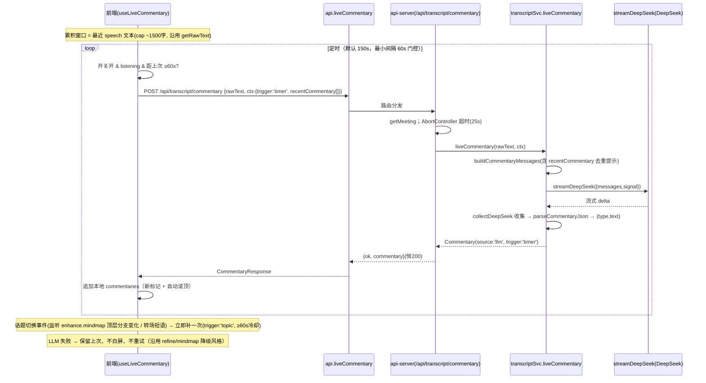
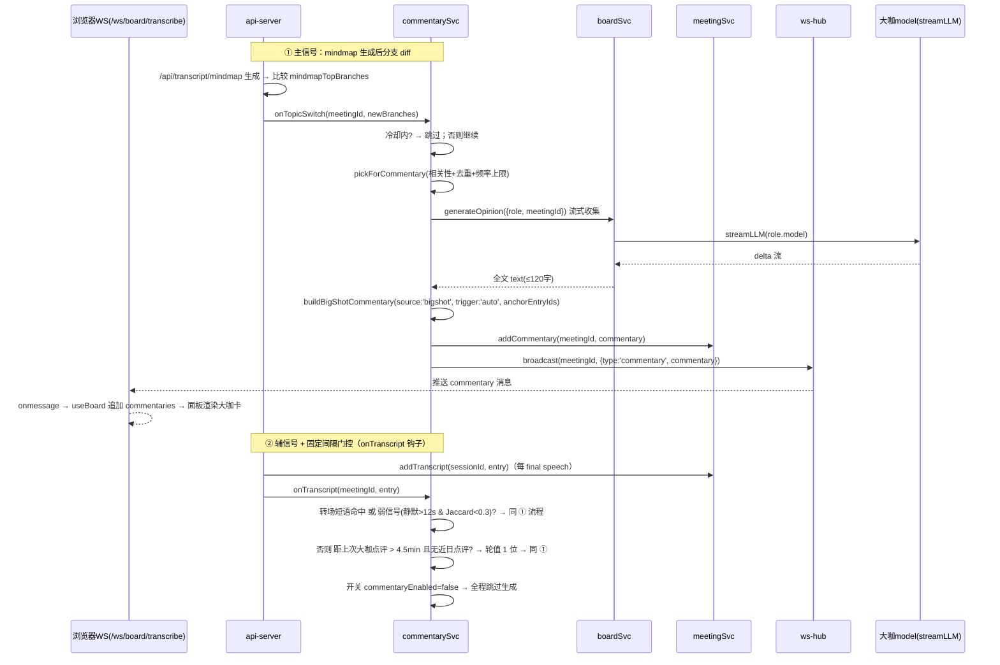

# AI 大咖会议私董会 · 会中实时反馈 / 点评（增量架构设计）

> 文档角色：架构师·高见远
> 版本：v1.0（增量设计稿，仅描述变更部分，不含既有功能）
> 日期：2026-07-09
> 依据：产品经理许清楚提供的增量 PRD（`docs/prd-live-commentary.md`）+ 已建成代码（`server/*`、`src/*`）
> 源码根：`d:\works\workbuddy\meetingOS\ai-board\`

---

## 一、变更范围说明（与既有架构的关系）

- **复用（不新增模型/配置）**：轻量点评复用 `server/transcript-service.mjs` 的 `streamDeepSeek`（DeepSeek `deepseek-v4-pro`，与润色/导图同一 model 同一网关）；大咖主动点评复用 `server/board-service.mjs` 的 `generateOpinion`/`speakForMeeting`（各角色 `model`，走 `streamLLM`）。
- **复用模式**：后端路由沿用 `api-server.mjs` 的「恒 HTTP 200 + `ok` 字段判定成败 + `degraded:true` 降级」模式（见 `/api/transcript/refine`、`/api/transcript/mindmap`）。
- **复用通道**：大咖主动点评的实时推送**复用现有 WebSocket 通道 `/ws/board/transcribe`**（按 `sessionId` 区分会议），仅新增 `commentary` 消息类型；不新建 SSE/WS 链路。
- **复用话题信号**：话题切换主信号直接复用每 5min 思维导图生成的**顶层分支集合**（后端已有，零额外 LLM 成本）；辅以转场短语 + 弱信号启发式。
- **命名避让（重要）**：既有 `useBoard` 中 `summary: Record<string,string>` 存放**各预设大咖的发言文本（用于底部 BigShotBar）**，本增量功能统一使用 `Commentary` / `commentaries` / `useLiveCommentary` 等命名，与既有 `summary` 互不干扰；`Opinion`（转录区大咖完整意见）与 `Commentary`（面板轻量点评流，含 llm 源 + 四类细分 + 时间锚点）并存不冲突。
- **不改动**：既有 ASR / 发言 SSE（`/speak`）/ 思维导图生成时机（仅*读取*其顶层分支）/ 资料解析链路均不改动；`maybeAuto` 关键词命中自动发言（注入转录区）保持原样——它被本设计的「大咖主动点评」并列而非替换（见 §八 #6）。

---

## 二、实现方案 + 框架选型（变更点）

| 项 | 选型 | 变更说明 |
|---|---|---|
| 前端框架 | React 19 + Vite + TS（沿用） | 无新增框架；样式**复用项目既有 CSS 变量**，沿用 `BoardRoom`/`BigShotBar` 视觉语言 |
| 后端运行时 | Node ESM `.mjs` + 原生 `http` + `ws`（沿用） | 单进程端口 3001，systemd `aiboard.service` |
| LLM 轻量点评 | `transcript-service.liveCommentary()` → `streamDeepSeek`（`deepseek-v4-pro`） | **新增函数**，复用 `collectDeepSeek` 文本收集与 JSON 解析策略 |
| 大咖主动点评 | `commentary-service` 调 `board-service.generateOpinion`/`speakForMeeting` | **新增服务**，仅改触发规则与展示位置（面板而非转录区） |
| 话题切换检测 | 后端 mindmap 顶层分支 diff（主）+ 转场短语/弱信号（辅） | **零额外 LLM 调用**；纯字符串/集合运算 |
| WS 推送 | `ws-hub`（新增微型模块）维护 `Map<sessionId, Set<ws>>` | 复用现有 `/ws/board/transcribe`，新增 `commentary` 消息 |
| 持久化 | `meeting-service` 会议对象新增 `commentaries[]` + `commentaryEnabled` + `mindmapTopBranches` | 内存 + JSON 落盘（沿用既有 `persist()`），供重启恢复与 C-P2-2 消费 |

**关键设计点**

1. **两类点评源，统一 `Commentary` 卡片**
   - `source:'llm'`：**前端驱动**。新增 Hook `useLiveCommentary` 定时（默认 150s）调 `POST /api/transcript/commentary`；话题切换事件触发时立即补一次（≥60s 冷却）。最小间隔门控 60s 防刷屏；随 `listening` 暂停/恢复；失败降级保留上次、不白屏、不重试。后端 `liveCommentary(transcriptWindow, ctx)` 产出 `{type, text}`（≤80 字，非总结）。
   - `source:'bigshot'`：**后端驱动**。新增 `commentary-service` 在①话题切换、②固定间隔门控（~4.5min，期间无大咖主动点评则轮值 1 位）时，挑最相关 1 位大咖 → 复用 `generateOpinion` 生成 → 构建 `Commentary(trigger:'auto')` → 落库 `meeting.commentaries` + **经 WS 推送到面板**。去重窗口 15min、频率上限 ≤20/会议、同时仅 1 位大咖主动点评。

2. **开关作用域（C-P0-5）**：面板头部「实时点评 开/关」→ 会议级 `commentaryEnabled`。关闭时：①前端停 LLM 定时采集；②后端跳过所有大咖主动点评生成；③面板进入静音态（不新增卡片、保留历史）。**不影响**底部 BigShotBar 手动「💬 发言」、也不影响既有 `maybeAuto` 自动发言（见 §八 #8）。

3. **大咖主动点评展示位（解决 PRD #6）**：仅进入「实时反馈」面板（按 `source:'bigshot'` 镜像为点评卡，复用 BigShotCard 的 avatar/color/姓名视觉语言），**不**再注入转录区，避免与 `Opinion` 重复显示。

4. **话题切换检测（零额外 LLM）**：
   - 主信号：后端 `/api/transcript/mindmap` 生成后，将顶层分支标题集合与 `meeting.mindmapTopBranches` 比较，新增/替换/移除即判切换。
   - 辅信号（前端不承担，后端 `addTranscript` 钩子执行）：最近窗口命中可配置转场短语词表，或弱信号（相邻 final 段间隔 > 12s 且新窗口与上一窗口词重叠率 Jaccard < 0.3）。
   - 去抖：切换触发后进入 60s 冷却，同窗口多次命中只触发一次。

---

## 三、文件列表及相对路径（新增/修改）

| 路径 | 层 | 类型 | 职责 |
|---|---|---|---|
| `server/transcript-service.mjs` | back | 改 | 新增 `liveCommentary(transcriptWindow, ctx)` + `buildCommentaryMessages` + `parseCommentaryJson`（沿用 `collectDeepSeek`） |
| `server/commentary-service.mjs` | back | **新** | 话题切换检测（mindmap 分支 diff + 转场短语 + 弱信号）、大咖挑选（`pickForCommentary`：focus 重叠 + 去重 + 频率上限 + 单发言门控）、固定间隔门控、`collectOpinion`、构建 `Commentary(source:'bigshot')`、`addCommentary` + `broadcastCommentary` |
| `server/ws-hub.mjs` | back | **新** | `Map<sessionId, Set<ws>>` 注册/注销/`broadcast(sessionId, payload)`（commentary 推送底座） |
| `server/board-service.mjs` | back | 改 | 新增 `pickForCommentary({roles, transcriptText, recentRoleIds, excludeSimilarWithinMs})`（相关性 + 去重 + 频率上限变体） |
| `server/meeting-service.mjs` | back | 改 | `Meeting` 增 `commentaries[]` + `commentaryEnabled` + `mindmapTopBranches`；`addCommentary` / `setCommentaryEnabled` / `getCommentaries` / `setMindmapTopBranches`；`updateMeeting` 支持 `commentaryEnabled`；`exportMarkdown` 增加「会中实时点评精选」段落（C-P2-2 接口） |
| `server/api-server.mjs` | back | 改 | 新增 `POST /api/transcript/commentary`（200 降级）；新增 `GET /api/meetings/:id/commentaries`；`PATCH /api/meetings/:id` 支持 `commentaryEnabled`；`/api/transcript/mindmap` 写入并比较 `mindmapTopBranches` → 触发 `commentarySvc.onTopicSwitch`；WS 连接注册进 `ws-hub`；`addTranscript` 后挂 `commentarySvc.onTranscript` |
| `src/types.ts` | 共享 | 改 | 新增 `Commentary` / `CommentarySource` / `CommentaryType` / `CommentaryTrigger` / `CommentaryRequest` / `CommentaryResponse` / `CommentaryListResponse` / `SetCommentaryEnabledRequest` |
| `src/lib/api.ts` | 前端 | 改 | 新增 `liveCommentary(req)`（200 降级 + 超时安全网）、`getCommentaries(id)`、`setCommentaryEnabled(id, enabled)` |
| `src/hooks/useLiveCommentary.ts` | 前端 | **新** | 定时 150s + 话题补（≥60s 冷却）+ 最小间隔 60s 门控 + 随 `listening` 暂停 + 降级保留上次；维护本地 llm 源 `commentaries`；暴露 `collecting/lastAt/count/error` |
| `src/hooks/useBoard.ts` | 前端 | 改 | WS `onmessage` 处理 `commentary` → 追加 `commentaries`；新增 `commentaries` / `commentaryEnabled` / `setCommentaryEnabled`；初始化拉取已有 `commentaries` 与 `commentaryEnabled` |
| `src/components/CommentaryPanel.tsx` | 前端 | **新** | 三栏第三栏：头部标题+开关+状态+计数；卡片流（最新在上、新标记、自动滚顶）；加载/空/降级/静音态；已收藏分组（P1） |
| `src/components/CommentaryCard.tsx` | 前端 | **新** | 单张点评卡（llm/bigshot 两种样式：类型标签、来源标识、时间锚点、新标记；P1 收藏⭐/忽略；P1-3 @关联；P2 情感/重要度） |
| `src/components/BoardRoom.tsx` | 前端 | 改 | 三栏布局（转录≈34% / 导图≈33% / 实时反馈≈33%）；挂载 `CommentaryPanel`，传入 `commentaries` + `commentaryEnabled` + `onToggle` + `onAnchor`（P1 联动） |
| `src/components/TranscriptPanel.tsx` | 前端 | 改 | 支持按 `anchorTs`/`anchorEntryIds` 滚动 + 高亮（C-P1-2） |

> 说明：`App.tsx` 无需改动（面板在 `BoardRoom` 内部，无新相位）；`BigShotBar`/`BigShotCard` 视觉语言被 `CommentaryCard` 复用但不改其发言逻辑。

---

## 四、数据结构与接口

### 4.1 类图（Mermaid）

```mermaid
classDiagram
    %% —— 新增后端服务 ——
    class CommentaryService {
      +Map~string,TopicState~ topicStates
      +Map~string,number~ bigShotCount
      +detectTopicSwitch(meetingId, newBranches) boolean
      +onTopicSwitch(meetingId, branches) void
      +onTranscript(meetingId, entry) void
      +pickForCommentary(opts) string|null
      +shouldFireFixedInterval(meetingId) boolean
      +collectOpinion(role, meetingId, signal) string
      +fireBigShot(meetingId, roleId) void
      -buildBigShotCommentary(role, text, anchor) Commentary
    }
    class WsHub {
      -Map~string,Set~ws~~ registry
      +register(sessionId, ws) void
      +unregister(sessionId, ws) void
      +broadcast(sessionId, payload) void
    }
    class TranscriptService {
      <<existing>>
      +refine(rawText, signal)
      +mindmap(rawText, title, signal)
      +normalizeMindmap(node, depth)
      +liveCommentary(window, ctx) Commentary
    }
    class BoardService {
      <<existing>>
      +assembleMessages(role, transcript, docs)
      +generateOpinion(opts)
      +autoPickSpeakers(opts)
      +pickForCommentary(opts) string
    }
    class MeetingService {
      <<existing>>
      +commentaries: Commentary[]
      +commentaryEnabled: boolean
      +mindmapTopBranches: string[]
      +addCommentary(meetingId, c) Commentary
      +setCommentaryEnabled(meetingId, v) void
      +getCommentaries(meetingId) Commentary[]
      +setMindmapTopBranches(meetingId, branches) void
    }
    class ApiServer {
      <<existing>>
      +route /api/transcript/commentary
      +route /api/meetings/:id/commentaries
      +route PATCH /api/meetings/:id (commentaryEnabled)
      +route /api/transcript/mindmap (branch-diff→onTopicSwitch)
    }

    %% —— 数据契约（src/types.ts）——
    class Commentary {
      +string id
      +CommentarySource source
      +string roleId
      +string roleCn
      +string color
      +CommentaryType type
      +string text
      +string ts
      +string anchorTs
      +string[] anchorEntryIds
      +CommentaryTrigger trigger
      +boolean pinned
      +boolean ignored
      +1|2|3 importance
    }
    class CommentaryRequest {
      +string rawText
      +CommentaryCtx ctx
    }
    class CommentaryCtx {
      +string meetingTitle
      +CommentaryTrigger trigger
      +string anchorTs
      +RecentCommentary[] recentCommentary
      +string[] topTopics
    }
    class CommentaryResponse
    class CommentaryListResponse
    class SetCommentaryEnabledRequest

    %% —— 前端 ——
    class useLiveCommentary {
      +Commentary[] commentaries
      +boolean collecting
      +number lastAt
      +number count
      +string error
      +tick() void
    }
    class useBoard {
      <<existing>>
      +Commentary[] commentaries
      +boolean commentaryEnabled
      +setCommentaryEnabled(v) void
    }
    class CommentaryPanel
    class CommentaryCard
    class ApiClient {
      <<existing lib/api.ts>>
      +liveCommentary(req) CommentaryResponse
      +getCommentaries(id) CommentaryListResponse
      +setCommentaryEnabled(id, v) void
    }

    ApiServer ..> CommentaryService : 触发/查询
    ApiServer ..> TranscriptService : liveCommentary 路由
    ApiServer ..> MeetingService : 读写 commentaries/enabled
    CommentaryService ..> BoardService : pickForCommentary/generateOpinion
    CommentaryService ..> MeetingService : 落库 addCommentary
    CommentaryService ..> WsHub : broadcast(commentary)
    ApiServer ..> WsHub : register/unregister
    CommentaryRequest *-- CommentaryCtx
    CommentaryResponse *-- Commentary
    CommentaryListResponse *-- Commentary
    useLiveCommentary ..> ApiClient : liveCommentary
    useBoard ..> ApiClient : getCommentaries/setCommentaryEnabled
    useBoard ..> WsHub : 接收 commentary 消息(浏览器侧)
    CommentaryPanel *-- CommentaryCard
    CommentaryPanel ..> useBoard : 取 commentaries/enabled
```



### 4.2 JSON Schema（核心数据结构）

**Commentary（点评卡片，统一契约）**
```json
{
  "$schema": "会中实时点评卡片",
  "type": "object",
  "required": ["id","source","type","text","ts","anchorTs","trigger"],
  "properties": {
    "id":             { "type": "string" },
    "source":         { "type": "string", "enum": ["llm","bigshot"] },
    "roleId":         { "type": "string", "description": "source='bigshot' 时填充" },
    "roleCn":         { "type": "string", "description": "大咖中文名" },
    "color":          { "type": "string", "description": "大咖主题色（CSS 变量值）" },
    "type":           { "type": "string", "enum": ["highlight","risk","clarify","suggestion"] },
    "text":           { "type": "string", "description": "内容（llm ≤80 字 / bigshot ≤120 字）" },
    "ts":             { "type": "string", "format": "date-time", "description": "生成时间" },
    "anchorTs":       { "type": "string", "format": "date-time", "description": "时间锚点（触发它的转录区间起点）" },
    "anchorEntryIds": { "type": "array", "items": { "type": "string" }, "description": "关联转录条目（P1 @关联）" },
    "trigger":        { "type": "string", "enum": ["timer","topic","auto"] },
    "pinned":         { "type": "boolean", "description": "收藏（P1）" },
    "ignored":        { "type": "boolean", "description": "忽略（P1）" },
    "importance":     { "type": "integer", "enum": [1,2,3], "description": "重要度（P2）" }
  }
}
```

**CommentaryRequest / CommentaryResponse**
```json
// Request（前端定时/话题补）
{ "rawText": "最近 ~3min 或 ~1500 字 speech 文本",
  "ctx": { "meetingTitle": "AI 落地节奏讨论",
           "trigger": "timer",
           "anchorTs": "2026-07-09T14:03:00.000Z",
           "recentCommentary": [ {"type":"highlight","text":"…"} ],
           "topTopics": ["获客成本","渠道 ROI"] } }

// Response（成功，恒 200）
{ "ok": true, "commentary": { "id":"c1","source":"llm","type":"suggestion","text":"…","ts":"…","anchorTs":"…","trigger":"timer" } }
// Response（本窗口无可点评，前端跳过）
{ "ok": true, "commentary": null }
// Response（降级，HTTP 仍 200）
{ "ok": false, "commentary": null, "error": "点评服务暂不可用，已保留历史", "degraded": true }
```

**WebSocket 推送协议（复用 `/ws/board/transcribe?sessionId=:id`）**
```json
// 既有（不变）
{ "type": "transcript", "text": "…", "final": true }
// 新增：大咖主动点评推送（server → browser）
{ "type": "commentary", "commentary": { "id":"c2","source":"bigshot","roleId":"zhang","roleCn":"张总","color":"#e23","type":"risk","text":"…","ts":"…","anchorTs":"…","anchorEntryIds":["e9","e10"],"trigger":"auto" } }
```

**SetCommentaryEnabledRequest（开关持久化）**
```json
// PATCH /api/meetings/:id  { "commentaryEnabled": false }
// GET  /api/meetings/:id/commentaries → { "ok": true, "commentaries": [ Commentary, … ], "commentaryEnabled": true }
```

### 4.3 新增 REST 接口一览

| Method | Path | 说明 | 请求 | 响应 |
|---|---|---|---|---|
| POST | `/api/transcript/commentary` | LLM 轻量点评（前端定时/话题补驱动，200 降级） | `CommentaryRequest` | `CommentaryResponse`（恒 200） |
| GET | `/api/meetings/:id/commentaries` | 拉取会议全部点评（刷新/重连恢复） | — | `CommentaryListResponse`（恒 200） |
| PATCH | `/api/meetings/:id` | 设置 `commentaryEnabled`（开关持久化） | `{commentaryEnabled:bool}` | `{ok:true, meeting}` |

---

## 五、程序调用流程（Mermaid 时序图）

### 5.1 LLM 轻量点评（定时 + 话题补，前端驱动）



### 5.2 大咖主动点评（后端驱动：话题切换 / 固定间隔 → WS 推送）



### 5.3 开关 / 降级 / 面板渲染

```mermaid
sequenceDiagram
    participant U as 用户
    participant P as CommentaryPanel
    participant UB as useBoard
    API as api.setCommentaryEnabled
    Srv as api-server(PATCH)

    U->>P: 点「实时点评 开/关」
    P->>UB: setCommentaryEnabled(false)
    UB->>API: PATCH /api/meetings/:id {commentaryEnabled:false}
    API->>Srv: 路由
    Srv->>Srv: meetingSvc.setCommentaryEnabled(false)
    Srv-->>API: {ok, meeting}
    API-->>UB: 本地 commentaryEnabled=false
    UB-->>P: 面板进入静音态（保留历史，不新增卡片）
    Note over UB: 前端 LLM 定时采集随 commentaryEnabled=false 暂停<br/>后端 bigshot 生成随 commentaryEnabled=false 跳过<br/>手动 💬 发言 / 既有 maybeAuto 不受影响
    Note over P: LLM 降级 → 头部「点评暂不可用」，保留历史卡片不白屏<br/>空态 → 「会议进行中，实时点评将自动出现在这里（点开关可静音）」
```

---

## 六、任务列表（有序、含依赖、按实现顺序）

| ID | 阶段 | 任务 | 依赖 | 源文件（新增/改） | 优先级 |
|---|---|---|---|---|---|
| **T1** | P0 | 后端·LLM 轻量点评：`liveCommentary()` + `/api/transcript/commentary` 路由 + `Commentary` 类型 + 持久化底座（`commentaries`/`commentaryEnabled`/`mindmapTopBranches` + `addCommentary`/`setCommentaryEnabled`/`getCommentaries`/`setMindmapTopBranches`） | — | `server/transcript-service.mjs`、`server/meeting-service.mjs`、`server/api-server.mjs`、`src/types.ts` | P0 |
| **T2** | P0 | 后端·大咖主动点评 + 话题切换检测 + WS 推送：`commentary-service` + `ws-hub` + `board-service.pickForCommentary` + mindmap 分支 diff 触发 + `addTranscript` 钩子 + `commentaries` GET/PATCH | T1 | `server/commentary-service.mjs`、`server/ws-hub.mjs`、`server/board-service.mjs`、`server/api-server.mjs`、`server/meeting-service.mjs` | P0 |
| **T3** | P0 | 前端·类型契约 + API 封装 + 状态机 Hook + 面板 + 三栏入口：新增 `useLiveCommentary`/`CommentaryPanel`，改 `api.ts`/`useBoard`(WS 收 commentary)/`BoardRoom`(三栏) | T1, T2 | `src/hooks/useLiveCommentary.ts`、`src/hooks/useBoard.ts`、`src/lib/api.ts`、`src/components/CommentaryPanel.tsx`、`src/components/BoardRoom.tsx` | P0 |
| **T4** | P0 | 前端·开关 + 状态/空态/降级 + 大咖卡镜像：`CommentaryCard`（llm/bigshot 双样式，复用 BigShotCard 视觉）+ 开关交互 + 静音/骨架/空/降级态 | T3 | `src/components/CommentaryCard.tsx`、`src/components/CommentaryPanel.tsx`、`src/components/BigShotCard.tsx`、`src/hooks/useBoard.ts` | P0 |
| **T5** | P1 | P1/P2 增强：收藏⭐/忽略 + 已收藏分组 + 转录时间轴联动高亮（C-P1-2）+ @关联转录条目（C-P1-3）+ 会后总结消费接口（C-P2-2：exportMarkdown 增「会中实时点评精选」） | T3 | `src/components/CommentaryCard.tsx`、`src/components/CommentaryPanel.tsx`、`src/hooks/useBoard.ts`、`src/components/TranscriptPanel.tsx`、`server/meeting-service.mjs` | P1 |

**关键路径**：T1 → T2 → T3 → T4（P0 收口）；T5（P1 可后置）。T2 与 T3 在 T1 完成后可并行推进。

**验收要点**
- T1：定时调 `POST /api/transcript/commentary` 返回 `Commentary(source:'llm')`；窗口无可点评返回 `commentary:null`（前端跳过）；LLM 失败降级 `degraded:true` 不白屏；`Commentary` 类型前后端一致。
- T2：mindmap 分支变化 → 大咖主动点评经 WS `commentary` 推到面板；去重 15min / 频率 ≤20 / 单发言门控生效；开关关时后端不生成；`ws-hub` 按 `sessionId` 精准推送。
- T3：三栏布局生效（转录/导图/实时反馈）；面板卡片流最新在上、新标记、自动滚顶；WS 收到 `commentary` 即渲染；刷新后 `getCommentaries` 恢复历史。
- T4：开关持久化（PATCH）+ 静音态；骨架/空/降级三态正确；大咖卡复用 BigShotCard 头像/色/姓名视觉。
- T5：收藏/忽略可用（P1）；点点评卡联动高亮转录（C-P1-2）；@关联展示（C-P1-3）；exportMarkdown 含点评精选（C-P2-2）。

---

## 七、依赖包列表

| 包 | 类型 | 用途 | 备注 |
|---|---|---|---|
| （无新增 npm 依赖） | — | — | 前端 React/Vite/TS、后端 `ws`/原生 `http` 均沿用 |
| `ws` | 后端既有依赖 | WebSocket 通道（复用 `/ws/board/transcribe`） | 已安装，仅新增消息类型 |
| `node:crypto` | Node 内置 | `randomUUID` 生成 `Commentary.id` | 内置 |
| `node:fs` | Node 内置 | `meeting-service` 既有的 `persist()` 落盘 `commentaries` | 内置 |

> 无新增第三方库；转场短语匹配用 `String.includes`、Jaccard 用原生数组运算，无需 NLP 依赖。

---

## 八、共享知识（前后端约定）

1. **`Commentary` 字段为唯一真理**：前后端共用 `src/types.ts` 中的 `Commentary` / `CommentarySource` / `CommentaryType` / `CommentaryTrigger`。大咖主动点评由 `Opinion` 生成并**镜像**为 `Commentary(source:'bigshot')` 进面板，二者 `roleId` 一致便于追溯。
2. **大咖角色表来源**：`commentary-service` 与 `board-service` 通过 `roleSvc.getRole(id)`（来自 `role-service.mjs`，22 位）取 `cn`/`color`/`focus`/`persona`/`model`；挑选相关性 = `focus` 关键词在最近转录窗口的命中数（复用 `autoPickSpeakers` 思路），去重与频率上限在 `commentary-service` 内维护。
3. **去重 key 规则**：
   - 大咖主动点评：`roleId` + 文本相似度（bigram Dice 系数）> 0.6 且发生在 `BIGSHOT_DEDUP_MS=900000`（15min）内 → 跳过。
   - LLM 轻量点评：前端在 `ctx.recentCommentary` 带最近 `RECENT_COMMENTARY_DEDUP_WINDOW=10` 条，prompt 显式要求避免重复；前端对返回 `text` 与最近条做相似度兜底跳过。
4. **阈值/配额常量（前后端一致命名，建议值，最终由主理人拍板）**：
   - `COMMENTARY_TIMER_MS = 150000`（150s，可配 120–180s）
   - `COMMENTARY_MIN_GAP_MS = 60000`（最小间隔防刷屏）
   - `COMMENTARY_TOPIC_COOLDOWN_MS = 60000`（话题切换补采冷却）
   - `LLM_COMMENTARY_MAX_CHARS = 80`、`BIGSHOT_COMMENTARY_MAX_CHARS = 120`
   - `BIGSHOT_DEDUP_MS = 900000`（15min）
   - `BIGSHOT_INTERVAL_MS = 270000`（4.5min 固定间隔门控）
   - `BIGSHOT_FREQ_CAP = 20`（单会议上限）
   - `TOPIC_SILENCE_MS = 12000`、`TOPIC_JACCARD_THRESHOLD = 0.3`
   - `TRANSITION_PHRASES = ['接下来','下一个议题','我们讨论','转到','换个话题','总结一下','那关于','回到']`
   - `RECENT_COMMENTARY_DEDUP_WINDOW = 10`
5. **降级约定（沿用 refine/mindmap）**：`/api/transcript/commentary` 恒 HTTP 200，以响应体 `ok` 判定成败；失败返回 `{ok:false, commentary:null, error, degraded:true}`；前端不白屏、保留历史、`commentary:null` 时静默跳过。前端 `liveCommentary` 封装沿用 `makeAbortController` 超时安全网（建议 25s，略小于后端 25s 一致）。
6. **开关作用域（明确边界）**：`commentaryEnabled=false` 仅暂停「实时反馈面板」的 LLM 采集（前端）与大咖主动点评生成（后端），并保留历史；**不影响**手动「💬 发言」、也不影响既有 `maybeAuto` 自动发言（见 §九 #8）。
7. **WS 消息类型契约**：浏览器侧 `useBoard` 新增 `ws.onmessage`：仅处理 `msg.type === 'commentary'`（其余 `transcript` 等消息本就被忽略，保持兼容）；`commentary` 消息 `commentary` 字段即 `Commentary` 对象，直接追加。
8. **持久化与会后消费**：`Commentary[]` 随 `meeting.commentaries` 落盘；C-P2-2 由并行「会后总结」功能读取（本期仅在 `exportMarkdown` 增加「会中实时点评精选」段落，优先取 `pinned`/高风险项，仅约定接口不生成总结）。

---

## 九、待明确事项（需主理人/用户拍板）

| # | 待明确 | 建议方案 | 影响 |
|---|---|---|---|
| 1 | **成本护栏数值**：① LLM 轻量点评 150s + 话题补（≥60s 冷却）→ 单会议（90min）约 36 + 少量补采 call，均走便宜的 `deepseek-v4-pro`；② 大咖主动点评走各角色 model（可能 LinkHarbor claude/gpt 更贵），频率上限 `≤20`/会议、且仅话题切换/固定门控触发 | 采纳上表常量；大咖主动点评严格受 `BIGSHOT_FREQ_CAP` + 开关双重约束 | 影响 T2 限频实现与费用 |
| 2 | **大咖主动点评参与范围**：全部 22 位还是仅「预设几位」 | 仅从 `meeting.roleIds`（本次会议受邀大咖）中挑选，相关性 = `focus` 命中；轮值兜底 | 影响 `pickForCommentary` |
| 3 | **去重相似度判定**：关键词重叠 vs LLM 语义去重 | 用 bigram Dice > 0.6（无额外 LLM，零成本） | 影响 T2 去重实现 |
| 4 | **单次长度上限**：llm ≤80 / bigshot ≤120 是否合适；`clarify` 可否更短 | 采纳；`clarify` 允许更短（≥15 字），prompt 约束 | 影响 `liveCommentary`/generateOpinion prompt |
| 5 | **话题切换阈值**：mindmap 分支「变化」判定、转场词表、弱信号 12s/Jaccard 0.3、是否零额外 LLM | 采纳上表常量 + 零额外 LLM（纯复用 mindmap + 启发式） | 影响 T2 检测实现 |
| 6 | **大咖主动点评展示位**：仅面板 vs 面板+转录区都显示 | **本设计采用：仅进面板**（避免与 `Opinion` 重复），手动 💬 仍走转录区不变 | 影响 T2 输出目标与 T4 视觉 |
| 7 | **`Commentary[]` 持久化与会后消费**：是否随会议落盘 | 采纳落盘（`meeting.commentaries`）；C-P2-2 仅留接口，由并行总结功能读取 | 影响 T1/T5 |
| 8 | **开关作用域**：仅静音面板，还是同时关掉底部 auto 自动发言 | **本设计采用：仅静音面板 LLM + 大咖主动**；手动发言与 `maybeAuto` 自动发言不受影响 | 影响 T3/T4 边界 |

> 其中 #1（成本）、#5（话题阈值）、#6（展示位）、#8（开关边界）建议优先拍板（影响 T1/T2/T3 实现与成本）；#2/#3/#4/#7 可在实现中按建议先行，留接口。

---

## 十、交付校验清单（Architect Sign-off）

- [x] 实现方案与框架选型（沿用现状，仅列变更点）
- [x] 文件列表及相对路径（新增/修改，标注 front/back）
- [x] 数据结构与接口（类图 + `Commentary` 契约 + WS `commentary` 协议 + 三 API 请求响应示例）
- [x] 程序调用流程（LLM 轻量点评时序 + 大咖主动点评/话题切换/WS 推送时序 + 开关降级时序）
- [x] 任务列表（5 项，有序含依赖，覆盖 P0 全链路 + P1/P2 增强）
- [x] 依赖包列表（基本无新依赖，复用 `ws`/原生模块）
- [x] 共享知识（字段真理 / 大咖角色表来源 / 去重 key / 阈值常量 / 降级约定 / 开关边界 / WS 契约 / 持久化）
- [x] 待明确事项（8 项，确需拍板者，含建议方案）
