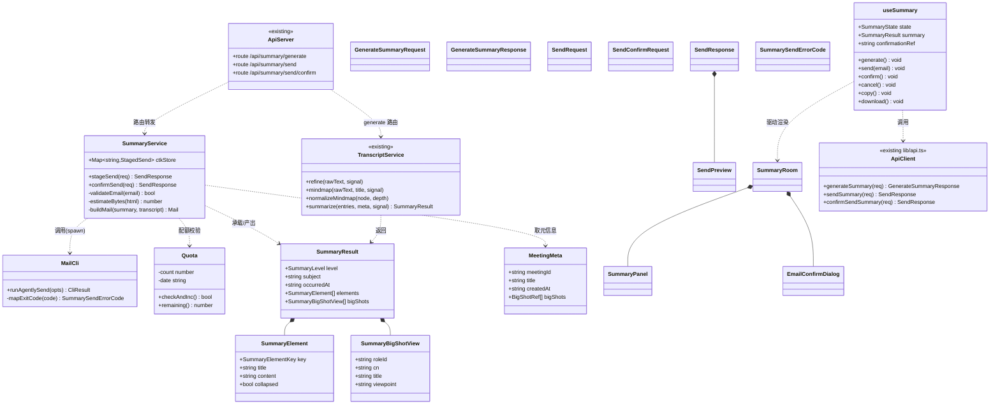
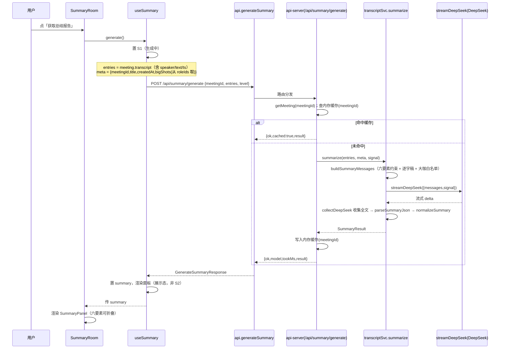
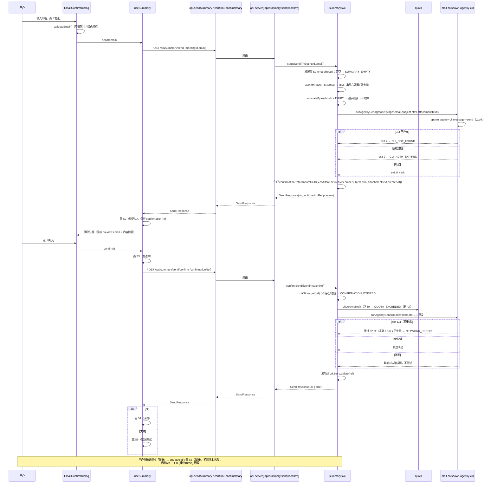

# AI 大咖会议私董会 · 会后总结 + 邮件发送（增量架构设计）

> 文档角色：架构师·高见远
> 版本：v1.0（增量设计稿，仅描述变更部分，不含既有功能）
> 日期：2026-07-09
> 依据：产品经理许清楚提供的增量 PRD + 主理人已拍板决策（LLM 复用 / 生成时机 / 逐字稿承载 / ctk 安全 / 限频 / 元信息 / 重试 / P2 多语言）
> 源码根：`d:\works\workbuddy\meetingOS\ai-board\`

---

## 〇、变更范围说明（与既有架构的关系）

- **复用（不新增模型/配置）**：总结生成复用 `server/transcript-service.mjs` 的 `streamDeepSeek`（DeepSeek `deepseek-v4-pro`，与润色/思维导图同一 model 同一网关）。
- **复用模式**：后端路由沿用 `api-server.mjs` 的「恒 HTTP 200 + `ok` 字段判定成败 + `degraded:true` 降级」模式（见 `/api/transcript/refine`、`/api/transcript/mindmap`）。
- **命名避让（重要）**：既有 `useBoard` 中已存在 `summary: Record<string,string>`（存放**各预设大咖的发言文本**），本增量功能统一使用 `SummaryResult` / `useSummary` / `meetingSummary` 等命名，避免与既有 `summary` 状态冲突。
- **会议结束态（新增概念）**：既有 `App` 仅有 `prep | board` 两相位，无"结束会议"概念。本设计新增 `phase: 'summary'`，由 BoardRoom「结束会议」按钮进入总结页。
- **不改动**：既有 ASR / 发言 SSE / 思维导图 / 资料解析链路均不改动。

---

## 一、实现方案 + 框架选型（变更点）

| 项 | 选型 | 变更说明 |
|---|---|---|
| 前端框架 | React 19 + Vite + TS + Tailwind（沿用） | 无新增框架 |
| 后端运行时 | Node ESM `.mjs` + 原生 `http` + `ws`（沿用） | 单进程端口 3001，systemd `aiboard.service` |
| 总结 LLM | `transcript-service.summarize()` → `streamDeepSeek`（`deepseek-v4-pro`） | **新增函数**，复用既有 LLM 调用与文本收集模式 |
| 总结缓存 | 进程内 `Map<meetingId, SummaryResult>` | 手动实时生成，按会议 id 缓存避免重复消耗 |
| 发信 | `child_process.spawn('agently-cli', ['message','+send', …])` | **新增** `summary-service` / `mail-cli` / `quota` 三模块封装两步确认 |
| ctk 安全 | 后端持有 `Map<confirmationRef, {ctk,…}>`，前端仅持 `confirmationRef` | 满足决策 #4 |
| 限频 | 进程内日计数器（`quota.mjs`，50/日，weispace@agent.qq.com） | 满足决策 #5（重启清零记为已知问题） |
| 状态机 | 前端 `useSummary` 实现 S0–S6 | S0空闲/S1生成中/S2待确认/S3发送中/S4成功/S5取消/S6错误降级 |

**关键设计点**
1. **生成时机**：用户点「获取总结报告」时实时调用 `POST /api/summary/generate`；后端按 `meetingId` 内存缓存，重复点击直接返回缓存（含 `cached:true`）。
2. **逐字稿承载**：默认 HTML 正文同时承载「总结六要素 + 全部逐字稿」；当 `Buffer.byteLength(html,'utf8') > 15MB` 时，逐字稿改为 `.txt` 附件（命名 `逐字稿_<meetingId>.txt`），HTML 仅含总结，留 5MB 安全余量应对 20MB 硬上限。
3. **两步确认**：`/api/summary/send`（step1）调 CLI 取回 `ctk`，后端生成 `confirmationRef` 并暂存 `{ctk, email, subject, html, attachmentText, createdAt}`，返回 `confirmationRef + preview`；`/api/summary/send/confirm`（step2）带 `confirmationRef` 回后端取 `ctk` 真发。
4. **配额计数时机**：在 step2（`confirmSend`）实际发送时计数，超限返回 `QUOTA_EXCEEDED`。

---

## 二、文件列表及相对路径（新增/修改）

| 路径 | 层 | 类型 | 职责 |
|---|---|---|---|
| `server/transcript-service.mjs` | back | 改 | 新增 `summarize(entries, meta, signal)` + `buildSummaryMessages` + `parseSummaryJson` + `normalizeSummary`（沿用 `collectDeepSeek`） |
| `server/summary-service.mjs` | back | **新** | 两步发信编排：`stageSend` / `confirmSend`；邮箱校验、字节估算、HTML/附件构造、`ctkStore` Map |
| `server/mail-cli.mjs` | back | **新** | `runAgentlySend({mode,email,subject,html,attachmentText,ctk})` 封装 `agently-cli`；退出码→错误码映射；重试 |
| `server/quota.mjs` | back | **新** | `weispace@agent.qq.com` 日配额计数（50/日），`checkAndInc()` / `remaining()` |
| `server/api-server.mjs` | back | 改 | 新增 `POST /api/summary/generate`、`POST /api/summary/send`、`POST /api/summary/send/confirm`（沿用 200 降级） |
| `src/types.ts` | 共享 | 改 | 新增 `SummaryResult` / `SummaryElement` / `SummaryBigShotView` / `MeetingMeta` / `GenerateSummaryRequest/Response` / `SendRequest` / `SendConfirmRequest` / `SendResponse` / `SendPreview` / `SummarySendErrorCode` / `SummaryLevel` |
| `src/lib/api.ts` | 前端 | 改 | 新增 `generateSummary` / `sendSummary` / `confirmSendSummary`（沿用 refine 的降级封装与超时安全网） |
| `src/lib/email.ts` | 前端 | **新** | `validateEmail()` 格式校验（前端禁空/禁非法，后端再校验） |
| `src/hooks/useSummary.ts` | 前端 | **新** | 状态机 S0–S6；持有 `confirmationRef`、`summary`；`generate/send/confirm/cancel/copy/download` |
| `src/App.tsx` | 前端 | 改 | `phase` 增加 `'summary'`；`phase==='summary'` 渲染 `<SummaryRoom>`；`onEnd` 回调 |
| `src/components/BoardRoom.tsx` | 前端 | 改 | 顶部新增「结束会议」按钮 → `onEnd`（进入总结态，结束即停收音） |
| `src/components/SummaryRoom.tsx` | 前端 | **新** | 总结阶段容器：挂载 `SummaryPanel` + `EmailConfirmDialog`；驱动 `useSummary`；S 态横幅 |
| `src/components/SummaryPanel.tsx` | 前端 | **新** | 六要素可折叠展示（读取 `SummaryResult.elements` + `bigShots` 表格） |
| `src/components/EmailConfirmDialog.tsx` | 前端 | **新** | 邮箱输入 + 发送按钮（空值禁用/格式校验）+ 两步确认弹窗（展示目标邮箱与内容摘要 → 确认/取消）+ 错误/降级提示 |

> 说明：`useBoard` 既有 `summary`（大咖发言文本）不改动；新功能的总结数据走 `useSummary`，二者互不干扰。

---

## 三、数据结构与接口

### 3.1 类图（Mermaid）



### 3.2 JSON Schema（核心数据结构）

**SummaryResult（六要素结构化结果）**
```json
{
  "$schema": "会议总结结果（六要素）",
  "type": "object",
  "required": ["level","subject","occurredAt","elements","bigShots"],
  "properties": {
    "level":        { "type": "string", "enum": ["brief","detailed"], "description": "v1 固定 detailed，预留 brief(P1)" },
    "subject":      { "type": "string", "description": "会议主题；缺失时 'AI大咖会议私董会'" },
    "occurredAt":   { "type": "string", "format": "date-time", "description": "会议时间，取自 meeting.createdAt" },
    "elements": {
      "type": "array",
      "description": "固定顺序六要素，每项可折叠",
      "items": {
        "type": "object",
        "required": ["key","title","content"],
        "properties": {
          "key":       { "type": "string", "enum": ["meta","topics","conclusions","actions","views","thread"] },
          "title":     { "type": "string", "description": "要素标题，如 '关键结论与决策'" },
          "content":   { "type": "string", "description": "该要素正文（markdown 文本）" },
          "collapsed": { "type": "boolean", "description": "默认是否折叠，v1 默认 false" }
        }
      }
    },
    "bigShots": {
      "type": "array",
      "description": "要素5 的结构化展开，供面板/邮件表格渲染",
      "items": {
        "type": "object",
        "required": ["roleId","cn","title","viewpoint"],
        "properties": {
          "roleId":   { "type": "string" },
          "cn":       { "type": "string", "description": "大咖中文名" },
          "title":    { "type": "string", "description": "头衔" },
          "viewpoint":{ "type": "string", "description": "核心观点摘要" }
        }
      }
    }
  }
}
```

**MeetingMeta（会议元信息，后端取自给前端）**
```json
{
  "meetingId": "a1b2c3d4",
  "title": "AI 落地节奏讨论",
  "createdAt": "2026-07-09T14:00:00.000Z",
  "bigShots": [
    { "id": "steve_jobs", "cn": "乔布斯", "title": "产品极致主义者" }
  ]
}
```

**GenerateSummaryRequest / Response**
```json
// Request
{ "meetingId": "a1b2c3d4",
  "entries": [ { "id":"e1","type":"speech","speaker":"主持人","text":"…","ts":"2026-07-09T14:01:12.000Z","final":true } ],
  "level": "detailed" }

// Response（成功，沿用 200 降级）
{ "ok": true, "model": "deepseek-v4-pro", "tookMs": 8200, "cached": false,
  "result": { "level":"detailed","subject":"AI 落地节奏讨论","occurredAt":"2026-07-09T14:00:00.000Z",
    "elements":[ {"key":"meta","title":"会议主题与时间","content":"…","collapsed":false},
                 {"key":"topics","title":"核心议题","content":"…"},
                 {"key":"conclusions","title":"关键结论与决策","content":"…"},
                 {"key":"actions","title":"行动项 / 待办","content":"…"},
                 {"key":"views","title":"各预设大咖核心观点摘要","content":"…"},
                 {"key":"thread","title":"整体脉络","content":"…"} ],
    "bigShots":[ {"roleId":"steve_jobs","cn":"乔布斯","title":"产品极致主义者","viewpoint":"节奏比完美重要…"} ] } }

// Response（降级，HTTP 仍 200）
{ "ok": false, "error": "总结服务暂不可用，已保留原始转录", "degraded": true }
```

**SendRequest / SendConfirmRequest / SendResponse / SendPreview**
```json
// SendRequest（step1）
{ "meetingId": "a1b2c3d4", "email": "boss@example.com", "level": "detailed" }
// SendConfirmRequest（step2）
{ "confirmationRef": "cfr_9f3a1b2c3d4" }
// SendResponse（step1 成功）
{ "ok": true, "confirmationRef": "cfr_9f3a1b2c3d4",
  "preview": { "email":"boss@example.com",
    "subject":"【AI大咖会议私董会】AI 落地节奏讨论 · 会议总结",
    "elementCount": 6, "hasAttachment": false, "sizeHintBytes": 48213 } }
// SendResponse（step1 失败 / 降级）
{ "ok": false, "code": "CLI_NOT_FOUND", "error": "发信组件未安装，请联系管理员", "degraded": true }
// SendResponse（step2 成功）
{ "ok": true, "preview": { "email":"boss@example.com","subject":"…","elementCount":6,"hasAttachment":false,"sizeHintBytes":48213 } }
// SendResponse（step2 配额耗尽）
{ "ok": false, "code": "QUOTA_EXCEEDED", "error": "今日发信额度已用完，请明日再试" }
```

**SummarySendErrorCode（错误码枚举）**
```json
["RECIPIENT_INVALID","QUOTA_EXCEEDED","CTK_MISSING","CLI_NOT_FOUND","CLI_AUTH_EXPIRED","NETWORK_ERROR","CONFIRMATION_EXPIRED","SUMMARY_EMPTY","MEETING_NOT_FOUND","UNKNOWN"]
```

### 3.3 新增 REST 接口一览

| Method | Path | 说明 | 请求 | 响应 |
|---|---|---|---|---|
| POST | `/api/summary/generate` | 生成六要素结构化总结（按 meetingId 缓存） | `GenerateSummaryRequest` | `GenerateSummaryResponse`（恒 200） |
| POST | `/api/summary/send` | 两步确认 step1：校验邮箱、构邮件、CLI 取 ctk、返回 `confirmationRef + preview` | `SendRequest` | `SendResponse`（恒 200） |
| POST | `/api/summary/send/confirm` | 两步确认 step2：取 ctk 真发、配额计数、退出码映射 | `SendConfirmRequest` | `SendResponse`（恒 200） |

---

## 四、程序调用流程（Mermaid 时序图）

### 4.1 生成总结时序



### 4.2 两步确认发信时序（含 CLI 调用与 ctk 暂存）



### 4.3 agently-cli 退出码 → 错误码映射（mail-cli.mjs）

| CLI 退出码 | 含义 | 处理 | 映射错误码 |
|---|---|---|---|
| 0 | 成功 | — | — |
| 1 | 服务端/网络抖动 | 重试 ≤2 次（退避 1.5s） | `NETWORK_ERROR`（重试后仍失败） |
| 2 | 授权过期 | 不重试 | `CLI_AUTH_EXPIRED` |
| 3 | 收件人无效 | 不重试 | `RECIPIENT_INVALID` |
| 4 | 本地网络 | 重试 ≤2 次 | `NETWORK_ERROR` |
| 6 | ctk 缺失 / 授权未就绪 | 不重试 | `CTK_MISSING` |
| 7 | CLI 未安装 | 不重试 | `CLI_NOT_FOUND` |
| 其他 | 未知 | 不重试 | `UNKNOWN` |

> 满足决策 #7：退出码 1/4 可重试（最多 2 次带短退避），2/3/6/7 不重试。

---

## 五、任务列表（有序、含依赖、按实现顺序）

> 说明：团队主理人建议拆为 T1–T6；为遵守"单轮任务数 ≤5"的工程约束，将前端 UI 相关项归并为 **T3（容器/面板/入口/状态机/API）+ T4（邮箱/两步确认/降级错误）+ T5（复制下载 P1）**，覆盖原 T3–T6 全部内容。

| ID | 阶段 | 任务 | 依赖 | 源文件（新增/改） | 优先级 |
|---|---|---|---|---|---|
| **T1** | P0 | 后端·总结生成：`summarize()` + `/api/summary/generate` 路由 | — | `server/transcript-service.mjs`、`server/api-server.mjs`、`src/types.ts` | P0 |
| **T2** | P0 | 后端·两步发信服务：`summary-service` + `mail-cli` + `quota` + `send`/`send/confirm` 路由（ctk 暂存 / CLI 封装 / 配额 / 字节估算 / 错误码映射） | T1 | `server/summary-service.mjs`、`server/mail-cli.mjs`、`server/quota.mjs`、`server/api-server.mjs` | P0 |
| **T3** | P0 | 前端·类型契约 + API 封装 + 状态机 + 总结面板 + 会议结束入口：新增 `useSummary`/`SummaryRoom`/`SummaryPanel`，改 `api.ts`/`App.tsx`/`BoardRoom.tsx` | T1, T2 | `src/types.ts`、`src/lib/api.ts`、`src/hooks/useSummary.ts`、`src/App.tsx`、`src/components/BoardRoom.tsx`、`src/components/SummaryRoom.tsx`、`src/components/SummaryPanel.tsx` | P0 |
| **T4** | P0 | 前端·邮箱输入 + 两步确认 + 降级/错误提示：`EmailConfirmDialog`（格式校验/空值禁用/确认弹窗/错误横幅） | T3 | `src/components/EmailConfirmDialog.tsx`、`src/lib/email.ts`、`src/components/SummaryRoom.tsx`（接入 S 态）、`src/components/SummaryPanel.tsx`（降级占位） | P0 |
| **T5** | P1 | 前端·总结复制 / 下载：复制全文、下载 Markdown | T3 | `src/hooks/useSummary.ts`（copy/download）、`src/components/SummaryPanel.tsx`（按钮）、`src/components/SummaryRoom.tsx`（挂载） | P1 |

**关键路径**：T1 → T2 → T3 → T4（P0 收口）；T5（P1 可后置）。

**验收要点**
- T1：点「获取总结报告」返回六要素 `SummaryResult`；重复点击命中缓存（`cached:true`）；LLM 失败降级 `degraded:true` 不白屏。
- T2：step1 返回 `confirmationRef + preview`，前端不接触 `ctk`；step2 真发成功；配额 51 次触发 `QUOTA_EXCEEDED`；CLI 缺失/过期分别降级；>15MB 自动转 `.txt` 附件。
- T3：新增总结相位可进入；六要素可折叠；状态机 S0–S6 正确流转。
- T4：空邮箱/非法格式禁用发送；确认弹窗展示目标邮箱 + 内容摘要；取消进 S5；失败进 S6 并可读提示。
- T5：复制/下载可用（P1）。

---

## 六、依赖包列表

| 包 | 类型 | 用途 | 备注 |
|---|---|---|---|
| （无新增 npm 依赖） | — | — | 前端 React/Vite/Tailwind、后端 `ws`/原生 `http` 均沿用 |
| `agently-cli` | 服务器本地 CLI | 两步确认发信（`message +send`，发件人固定 `weispace@agent.qq.com`） | **非 npm 依赖**，由 `child_process.spawn` 调用；需确认已在腾讯云 `/opt/aiboard` 预装且授权有效 |
| `node:child_process` | Node 内置 | spawn `agently-cli` | 内置，无需安装 |
| `node:fs` / `node:crypto` | Node 内置 | 写 `.txt` 附件临时文件 / `randomUUID` 生成 `confirmationRef` | 内置 |

> 邮箱格式校验用正则实现（无需第三方库）；无 tiny 工具新增。

---

## 七、共享知识（前后端约定）

1. **错误码（唯一真理）**：前后端共用 `SummarySendErrorCode`（`src/types.ts`）。前端据 `code` 展示对应可读文案；`degraded:true` 一律进 S6 并显示提示而非白屏。
2. **confirmationRef 生命周期（ctk 后端持有）**：`stageSend` 生成（`crypto.randomUUID`，后端内存 `Map<confirmationRef,{ctk,email,subject,html,attachmentText,createdAt}>`，**建议 TTL 10 分钟**）→ `confirmSend` 消费并删除；前端**仅持有 `confirmationRef`，绝不接触 `ctk`**。取消时前端清本地态，后端 ref 由 TTL 清理。
3. **阈值/配额常量（前后端一致命名）**：
   - `SUMMARY_TXT_FALLBACK_BYTES = 15 * 1024 * 1024`（15MB）：超过则逐字稿转 `.txt` 附件。
   - `MAIL_HARD_LIMIT_BYTES = 20 * 1024 * 1024`（20MB）：邮件硬上限（前端仅做预览提示，后端控实际）。
   - `DAILY_QUOTA = 50`：`weispace@agent.qq.com` 日配额（进程内计数，重启清零——已知问题）。
   - `SEND_MAX_RETRIES = 2`、`SEND_RETRY_BACKOFF_MS = 1500`：退出码 1/4 重试。
   - `CONFIRMATION_TTL_MS = 10 * 60 * 1000`（建议，待确认）：`ctkStore` 定时清理。
4. **缓存 key 规则**：总结内存缓存按 `meetingId`（与 `ctkStore` 的 `confirmationRef` 分离）；`generate` 命中缓存直接返回，避免重复消耗 LLM。
5. **降级约定（沿用 refine/mindmap）**：`/api/summary/*` 恒 HTTP 200，以响应体 `ok` 判定成败；失败时返回 `{ok:false, error:'…', degraded:true}` 或 `{ok:false, code, error}`（不回显密钥/堆栈）。
6. **邮件正文构成**：HTML 承载总结六要素（每要素一节）+ 全部逐字稿（段落流）；`>15MB` 时逐字稿改 `.txt` 附件（命名 `逐字稿_<meetingId>.txt`），HTML 仅含总结 + "逐字稿见附件"提示。发件人固定 `weispace@agent.qq.com`，前端不传。
7. **会议元信息来源**：`subject` 取自 `meeting.title`（缺失处理见 §八待明确 #1）；`occurredAt` 取自 `meeting.createdAt`；`bigShots` 由 `meeting.roleIds` 经 `role-service.getRole` 映射为 `{id,cn,title}`，作为 LLM 区分"预设大咖"的白名单。

---

## 八、待明确事项（仅剩需主理人/用户拍板者）

| # | 待明确 | 建议方案 | 影响 |
|---|---|---|---|
| 1 | **主题默认标题冲突**：`meeting-service.createMeeting` 默认 `'未命名私董会'`，决策 #6 要求缺失时默认 `'AI大咖会议私董会'` | 总结生成时 `subject = (title && title !== '未命名私董会') ? title : 'AI大咖会议私董会'`；或统一把 `createMeeting` 默认值改为 `'AI大咖会议私董会'` | 影响要素1 主题显示 |
| 2 | **"会议结束态"触发方式**：既有无结束概念 | 新增 `phase:'summary'`，BoardRoom 顶部「结束会议」→ `onEnd` → `SummaryRoom`；允许"收音中"直接结束（结束即停收音）；v1 仅前端相位，不落库 `endedAt` | 影响入口与状态机 |
| 3 | **agently-cli 接口契约待实机验证**：两步参数名（stage 返回 `ctk` 的字段/stdout 格式、confirm 带 `ctk` 的参数名）、发件人固定为 `weispace@agent.qq.com` 的确认、CLI 是否全局可用 | 工程侧在 `/opt/aiboard` 实机验证 CLI 存在与授权有效；否则走 `CLI_NOT_FOUND`/`CLI_AUTH_EXPIRED` 降级 | 影响 T2 实现细节 |
| 4 | **大咖核心观点（要素5）数据来源**：以 `meeting.transcript` 中 `type==='opinion'` 且带 `speaker` 的条目为主（与既有 `useBoard.summary` 同源），辅以 `speech` 中 speaker 标注 | 前端传 `meeting.transcript` 全量 entries（已覆盖 opinion + speech）；`meta.bigShots` 提供白名单；无需重复传 `meeting.opinions` | 影响要素5 质量 |
| 5 | **confirmationRef TTL**：决策未规定 | 建议 10 分钟 TTL（内存 Map 定时清理）防泄漏/误用 | 影响安全性与内存 |
| 6 | **P1 `level`（简/详）开关**：v1 是否连 level 切换都做 | 建议 v1 固定 `detailed`，仅预留 `level` 字段；P1 再加前端切换 | 影响范围 |

> 其中 #1、#2、#3、#5 建议优先拍板（影响 T1/T2/T3 实现与安全性）；#4、#6 可在实现中按建议先行，留接口。

---

## 九、交付校验清单（Architect Sign-off）

- [x] 实现方案与框架选型（沿用现状，仅列变更点）
- [x] 文件列表及相对路径（新增/修改，标注 front/back）
- [x] 数据结构与接口（类图 + SummaryResult 六要素/MeetingMeta/Send*/错误码 + 两 API 请求响应示例）
- [x] 程序调用流程（生成总结时序 + 两步确认发信时序含 CLI/ctk 暂存 + 退出码映射）
- [x] 任务列表（5 项，有序含依赖，覆盖原 T1–T6）
- [x] 依赖包列表（基本无新依赖，agently-cli 为本地 CLI）
- [x] 共享知识（错误码 / confirmationRef 生命周期 / 15MB 阈值常量 / 缓存 key / 降级约定）
- [x] 待明确事项（6 项，确需拍板者）
