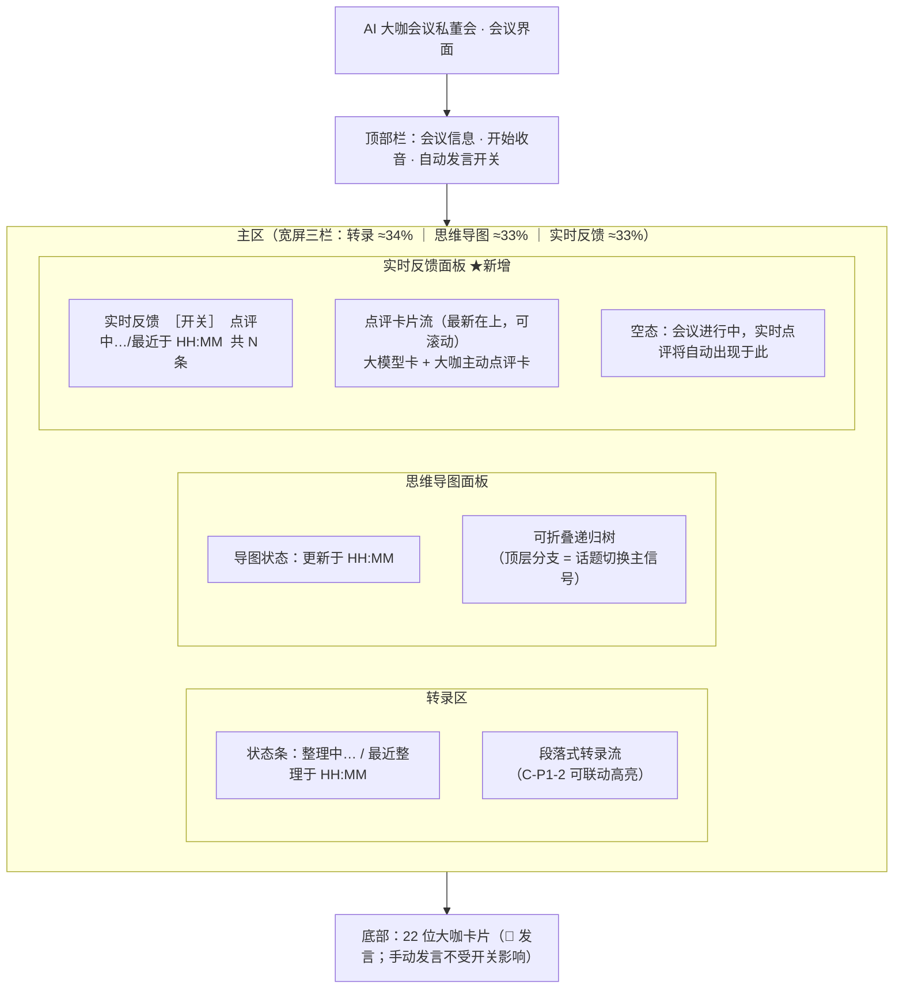
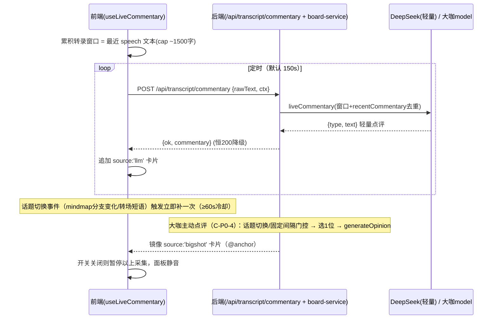

# PRD（增量）· 会议进行中「实时反馈 / 点评」面板

> 增量 PRD（仅描述变更部分）。面向已上线的「AI 大咖会议私董会」，在 **实时转录 + 思维导图（T1–T9 已建成）** 之上，新增独立的**会中实时点评流**。
> 不重复设计已建能力；不重复设计并行的「会后完整总结 + 邮件发送」功能（另一 PRD/架构负责）。

## 0. 增量说明（本 PRD 的范围边界）

| 维度 | 已建成（复用，不重做） | 本期新增（本 PRD 的 delta） |
| --- | --- | --- |
| 转录 | 段落化 + 每 60s LLM 整理（`refine`） | — |
| 思维导图 | 每 5min LLM 导图（`mindmap`） | 复用其**顶层分支**作为「话题切换」主信号 |
| 大咖发言 | 手动「💬 发言」+ 自动关键词命中（`autoPickSpeakers`/`maybeAuto`） | 扩展为**规则触发（话题切换 + 固定间隔门控）+ 去重 + 频率上限**，并镜像到新面板 |
| 会后产物 | （并行）一次性完整结构化总结 + 邮件 | 不在此做；本期点评数据 P2 可被其消费 |

**核心痛点**：飞书妙记式「会后整理」再漂亮也晚了——好建议必须发生在**会议进行中**，否则任务已安排完、复盘无意义。
**一句话目标**：在会议进行中，用「大模型轻量点评 + 大咖主动插话」的持续流，把可执行的亮点/风险/待澄清/建议实时推到独立面板，让主持人/参会者当场就能用。

---

## 1. 项目信息

| 项 | 内容 |
| --- | --- |
| Language | 中文（zh-CN） |
| Programming Language | 前端 React 19 + Vite + TypeScript(strict)；后端 Node ESM（`server/*.mjs`）；样式**沿用项目既有 CSS 变量体系（非 MUI，复用现有 BoardRoom / BigShotBar 样式）** |
| Project Name | `live_commentary_panel` |
| 部署现状 | 沿用 `/opt/aiboard`，线上 `meeting.weispace.com.cn`，systemd `aiboard.service`，端口 3001 |
| 复用链路 | `server/transcript-service.mjs`（`refine`/`mindmap`）、`server/llm-router.mjs`（`streamDeepSeek`/`streamLLM`）、`server/api-server.mjs`（`/api/transcript/*` 恒 200 降级）、`server/board-service.mjs`（`speakForMeeting`/`autoPickSpeakers`/`assembleMessages`）、`src/hooks/useTranscriptEnhance.ts`、`src/hooks/useBoard.ts`（`maybeAuto`/`requestSpeak`）、`src/components/BoardRoom.tsx`、`src/components/BigShotBar.tsx`、`src/types.ts` |
| LLM 复用 | 轻量点评 → 与润色/导图同模型 `deepseek-v4-pro`（`streamDeepSeek`）；大咖主动点评 → 各角色自身 `model`（`streamLLM`，可能走 LinkHarbor 的 claude/gpt，成本更高，见待确认问题 1） |

### 原始需求复述
参考飞书妙记的「实时文字稿 + 思维导图」（已实现）。在其基础上增加**大咖与大模型的实时反馈/点评**：定时 + 话题驱动产出轻量点评，大咖在关键节点**主动**插话点评（去重、频率上限、不喧宾夺主），集中展示在独立的「实时反馈」面板，并支持随时开/关静音——确保好建议发生在会议进行中而非会后复盘。

---

## 2. 产品目标

让「AI 大咖会议私董会」从「会中记录 + 会后复盘」升级为**会中即可纠偏**：在会议进行中以低成本、低打扰的持续点评流，把可执行亮点/风险/待澄清/建议实时送达，使主持人能在任务布置前就采纳建议，而非等会议结束才看到「正确的废话」。

---

## 3. 用户故事

1. **作为会议主持人**，我希望每 2–3 分钟自动收到一条「刚刚这段讨论」的轻量点评（亮点/风险/建议），以便我在议题推进中当场纠偏，而不是会后才知道该怎么做。
2. **作为参会者**，我希望看到大咖在关键节点**主动**插话点评（而非仅我点击才发言），以便借大咖视角即时校准讨论方向。
3. **作为深度参与者**，我希望点评按「亮点/风险/待澄清/建议」分类并带时间锚点，以便我快速定位「这句话对应会议的哪一段」。
4. **作为易被打断的用户**，我希望随时用开关静音实时点评，以便我在专注听人讲话或自由讨论时不被点评流干扰。
5. **作为复盘者**，我希望被我「收藏」的会中点评能沉淀进会后总结，以便会中火花不随会议结束而丢失。

---

## 4. 需求池（P0 / P1 / P2）

> 优先级：P0 必须（MVP 核心链路）｜P1 应有（体验增强）｜P2 可选（锦上添花）
> 标注：**前端** / **后端** / **前后端**。
> 数据来源约定：点评窗口 = `entries.filter(e => e.type==='speech')` 最近一段（默认最近 ~3 分钟或最近 ~1500 字符，截断保护 prompt 长度，沿用 `getRawText` 思路）。

### P0（必做）

| 编号 | 端 | 需求 | 说明 / 验收 |
| --- | --- | --- | --- |
| **C-P0-1** | 前端 | 实时点评流展示面板 | BoardRoom 在「转录 + 思维导图」之外新增**独立实时反馈区**（三栏布局之一）。卡片流、可滚动、最新在上、新卡带「新」标记并自动滚到顶部；面板头部含标题「实时反馈」+ 开关 + 状态（点评中…/最近于 HH:MM）+ 计数。含加载态（骨架/「点评中…」）与空态（「会议进行中，实时点评将自动出现于此，点开关可静音」）。 |
| **C-P0-2** | 后端 | LLM 实时点评（轻量、非总结） | `server/transcript-service.mjs` 新增 `liveCommentary(transcriptWindow, ctx)`：复用 `streamDeepSeek`（`deepseek-v4-pro`）；输入「最近转录窗口 + ctx{meetingTitle, recentCommentary[], topTopics[]}」；输出**简短点评**（≤80 字，给 1–2 条可执行点，**非完整总结**），并带 `type ∈ {highlight, risk, clarify, suggestion}`。新增 `POST /api/transcript/commentary`，**沿用 refine/mindmap 的恒 200 降级**（失败返回 `{ok:false, commentary:null, degraded:true}`）。 |
| **C-P0-3** | 前端 | 定时 + 话题驱动触发采集 | 新增类 `useTranscriptEnhance` 的 Hook `useLiveCommentary`：**定时**（默认 150s，可配 120–180s）调 C-P0-2；**话题切换事件**触发时立即补一次（见 C-P0-7）。最小间隔门控（建议 60s）防刷屏；随 `listening` 暂停/恢复（与现有 enhance 一致）；失败降级保留上次、不白屏、不重试。 |
| **C-P0-4** | 前后端 | 大咖主动点评（规则触发 + 去重 + 频率上限） | 扩展既有 auto 规则引擎（`autoPickSpeakers`/`maybeAuto`）：① 话题切换时挑最相关 1 位大咖主动插话；② 固定间隔门控（建议每 ~4–5min，若期间无大咖主动点评则轮值 1 位补一句，避免长静默）；③ 去重窗口（同一大咖相似点 15min 内不重复）；④ 频率上限（单会议 ≤ ~20 次；同时发言大咖 ≤ 1，避免抢话）。生成复用 `generateOpinion`（各角色 model），并**镜像**为 `source:'bigshot'` 点评卡片进入面板（见 C-P0-6）。 |
| **C-P0-5** | 前后端 | 实时点评开关 | 面板头部「实时点评 开/关」开关。关闭时：暂停 C-P0-3 采集（LLM + 大咖主动），面板进入静音态（不新增卡片、可显历史）；**不关闭**底部 BigShotBar 的手动「💬 发言」。重新开启即从下一 tick 恢复。状态持久化到会议级 `active` 标志。 |
| **C-P0-6** | 前后端 | 点评卡片数据结构 `Commentary` | 新增类型（见 §5.3）。字段至少含：`source`(谁说的：llm/bigshot)、`roleId`/`roleCn`/`color`(大咖时)、`type`(亮点/风险/待澄清/建议)、`text`(内容)、`ts`(生成时间)、`anchorTs`(时间锚点，指向触发它的转录区间)、`trigger`(timer/topic/auto)。 |
| **C-P0-7** | 前后端 | 话题切换检测（产品可接受方案） | 采用**低成本混合信号**（默认不额外发 LLM 调用检测）：①**主信号**＝复用每 5min 思维导图——其 top-level 分支集合出现新增/替换即判议题切换；②**转场短语启发式**＝最近窗口命中可配置词表（「接下来/下一个议题/我们讨论/转到/换个话题/总结一下/那关于/回到…」）即触发；③**弱信号**＝相邻 final 段间隔 > 阈值（建议 12s）且新窗口与上一窗口词汇重叠率 < 阈值（建议 Jaccard < 0.3）。去抖：切换触发点评后进入 60s 冷却，同窗口多次命中只补一次。具体阈值由架构师在建议值内拍板。 |

### P1（应有）

| 编号 | 端 | 需求 | 说明 / 验收 |
| --- | --- | --- | --- |
| **C-P1-1** | 前后端 | 点评「收藏 / 忽略」 | 每张卡片提供「收藏 ⭐ / 忽略」操作；收藏集在面板顶部「已收藏」分组（或筛选）；忽略卡折叠/降权不删除。状态随会议持久化。 |
| **C-P1-2** | 前端 | 点评 ↔ 转录时间轴联动高亮 | 点击点评卡 → 转录区自动滚到并高亮其 `anchorTs` 对应的转录段落（反向：hover/选中转录段可提示相关点评）。 |
| **C-P1-3** | 前后端 | 大咖点评 @ 关联某条转录 | `source:'bigshot'` 卡片除时间锚点外，可 @ 关联 1–N 条具体转录条目（`anchorEntryIds`），卡片上显示「@ 12:01 张总发言」式引用，点击跳转。 |

### P2（可选）

| 编号 | 端 | 需求 | 说明 / 验收 |
| --- | --- | --- | --- |
| **C-P2-1** | 前后端 | 点评情感 / 重要度标记 | 卡片显示情感极性（正向/中性/负向）与重要度（1–3 星）；可作为面板排序/筛选维度（如「只看高风险」）。 |
| **C-P2-2** | 后端 | 点评汇总进会后总结 | 将 `Commentary[]` 随会议持久化，供并行的「会后完整总结 + 邮件」功能消费（在总结中单列「会中实时点评精选」，优先取收藏/高风险项）。仅约定数据接口，不在本期生成总结。 |

---

## 5. UI 设计稿

### 5.1 会议界面新布局（三栏 + 底部大咖条）



**响应式**：宽屏（≥1280px）三栏并排；中屏（<1280px）「转录 + 思维导图」上下排，实时反馈作为可折叠右抽屉/下方区块；窄屏用标签页切换三区。

### 5.2 点评采集数据流（mermaid）



### 5.3 点评卡片数据结构（字段表，非代码）

| 字段 | 类型 | 含义 | 来源 |
| --- | --- | --- | --- |
| `id` | string | 卡片唯一 id | 前端/后端生成 |
| `source` | `'llm'` \| `'bigshot'` | 谁说的：大模型轻量点评 / 某大咖主动点评 | C-P0-2 / C-P0-4 |
| `roleId` / `roleCn` / `color` | string | 大咖 id/中文名/色（source='bigshot' 时填充；llm 时为空） | role-service |
| `type` | `'highlight'`\|`'risk'`\|`'clarify'`\|`'suggestion'` | 亮点 / 风险 / 待澄清 / 建议 | LLM 分类输出 |
| `text` | string | 点评内容（轻量 ≤80 字；大咖 ≤120 字） | liveCommentary / generateOpinion |
| `ts` | string(ISO) | 点评生成时间 | 生成时 |
| `anchorTs` | string(ISO) | 时间锚点（指向触发它的转录区间起点） | 触发时记录 |
| `anchorEntryIds` | string[] | 关联的具体转录条目（P1 @关联） | C-P1-3 |
| `trigger` | `'timer'`\|`'topic'`\|`'auto'` | 触发方式：定时 / 话题切换 / 大咖主动 | 采集逻辑 |
| `pinned` / `ignored` | boolean | 收藏 / 忽略（P1） | C-P1-1 |
| `importance` | 1–3 | 重要度（P2） | C-P2-1 |

> 与既有 `Opinion` 类型区分：`Opinion` 是会中/会后大咖「完整意见」（severity: info/warn/risk），本 `Commentary` 是会中**轻量点评流**的统一卡片（含大模型源 + 四类细分 + 时间锚点 + 触发方式），二者并存不冲突；大咖主动点评由 `Opinion` 生成并**镜像**为 `Commentary` 进面板。

### 5.4 点评卡片视觉样式（ASCII）

```
大模型轻量点评卡（source='llm'）：
┌──────────────────────────────────────────────┐
│ 🤖 大模型  │ 建议          12:03   ● 新       │  ← 标识 + 类型标签 + 时间 + 新标记
│ 围绕「获客成本」议题，建议先定义最小可行闭环：  │
│ 用 100 个样本验证假设，再决定是否铺渠道。        │
│ 🕓 锚定 11:58–12:02            ［收藏］［忽略］ │  ← 时间锚点(可点联动) + P1操作
└──────────────────────────────────────────────┘

大咖主动点评卡（source='bigshot'）：
┌──────────────────────────────────────────────┐
│ ● 张总(红)  │ 风险  主动点评   12:05           │  ← 头像色 + 姓名 + 类型 + 「主动点评」标识
│ 刚才对渠道 ROI 的判断偏乐观，建议先留出 20%     │
│ 预算做对冲，避免 Q3 一次性押满。                │
│ 🕓 锚定 12:00–12:04   @ 12:01 张总发言   ［收藏］│  ← 时间锚点 + P1 @关联
└──────────────────────────────────────────────┘
```

### 5.5 状态与空态

| 状态 | 呈现 |
| --- | --- |
| 采集中 | 面板头部「点评中…」+ 卡片区顶部骨架/微光动画 |
| 正常 | 头部「最近于 HH:MM ｜ 共 N 条」 |
| 降级（LLM 失败） | 头部「点评暂不可用」，保留历史卡片，不白屏（沿用 refine/mindmap 降级风格） |
| 开关关闭 | 头部开关置灰 + 面板显示「实时点评已静音，点开恢复」 |
| 空态 | 「会议进行中，实时点评将自动出现在这里（点开关可静音）」 |

---

## 6. 待确认问题（需架构师 / 用户拍板）

1. **成本护栏数值**（最关键）：① LLM 轻量点评用 `deepseek-v4-pro`（便宜），定时 150s + 话题补（≥60s 冷却）→ 单会议（按 90min）约多少 call / 费用？② 大咖主动点评走各角色 model（可能 LinkHarbor 的 claude/gpt，**更贵**），其频率上限建议多少（如 ≤20 次/会议）？是否对大咖主动点评单独设预算上限或仅在「话题切换/固定门控」时触发以控成本？
2. **大咖主动点评的参与范围**：是所有 22 位大咖都可能主动插话，还是仅「预设的几位」（如 brief 里「预设大咖」）？轮值/相关性挑选规则由谁定（focus 命中 / 轮询 / 主持人指定）？
3. **去重时间窗与相似度判定**：大咖 15min 去重窗是否合适？相似点判定用「同一大咖 + 关键词重叠」还是「LLM 语义去重」？轻量点评的 `recentCommentary` 去重回溯窗口取多少条（如最近 10 条）？
4. **单次点评长度上限**：轻量点评 ≤80 字、大咖主动 ≤120 字是否合适？是否允许大咖主动点评偶发「先抛一个关键追问」（即 `type:'clarify'` 可更短）？
5. **话题切换检测的具体信号与阈值**：① 主信号「mindmap 顶层分支变化」——判定为「新增/替换」的相似度阈值？② 转场短语词表是否就按 §4 C-P0-7 默认集，还是用户/架构师增删？③ 弱信号静默阈值（12s）与词汇重叠率（Jaccard<0.3）是否采纳？④ 是否接受「检测本身不发额外 LLM 调用」（纯复用 mindmap + 启发式）？
6. **大咖主动点评在转录区 vs 面板的呈现关系**：现 auto 发言会把 opinion 注入转录面板（`type:'opinion'`）。新增后，大咖**主动**点评是否「仅进新面板」还是「面板 + 转录区都显示（去重）」？手动「💬 发言」是否仍走转录区不变？需定「权威展示位」避免重复/混淆。
7. **数据持久化与会后消费**：`Commentary[]` 是否随会议落盘（`meeting-service` 新增 `commentaries` 数组，参照 `opinions`）？C-P2-2 的「汇总进会后总结」是否本期仅留接口、由并行总结功能读取？
8. **开关的作用域**：开关仅静音「实时反馈面板」（LLM + 大咖主动采集），**不**影响手动发言与 auto 自动发言——该边界是否如 §4 C-P0-5 所述？还是希望开关同时关掉底部 auto 自动发言？

---

## 7. 范围与边界（明确不做）

- 不做「会后完整总结 + 邮件发送」（并行功能，另一 PRD/架构负责）；本期仅做会中轻量增量点评流，C-P2-2 仅约定数据接口。
- 不改动已建 T1–T9 的转录段落化、60s 整理、5min 导图（仅**读取**其 mindmap 顶层分支作为话题信号）。
- 不引入新前端 UI 框架（沿用项目既有 CSS 变量，复用 BoardRoom/BigShotBar 样式）。
- 不新增独立「发言 SSE」链路：大咖主动点评复用既有 `generateOpinion`/`speakForMeeting` 生成能力，仅改变**触发规则**与**展示位置**。
- 话题切换检测默认不单独发起 LLM 调用（避免成本叠加），以 mindmap 复用 + 启发式为主。
