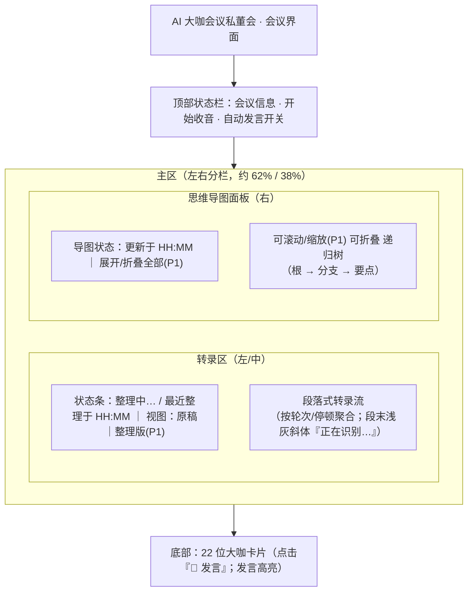
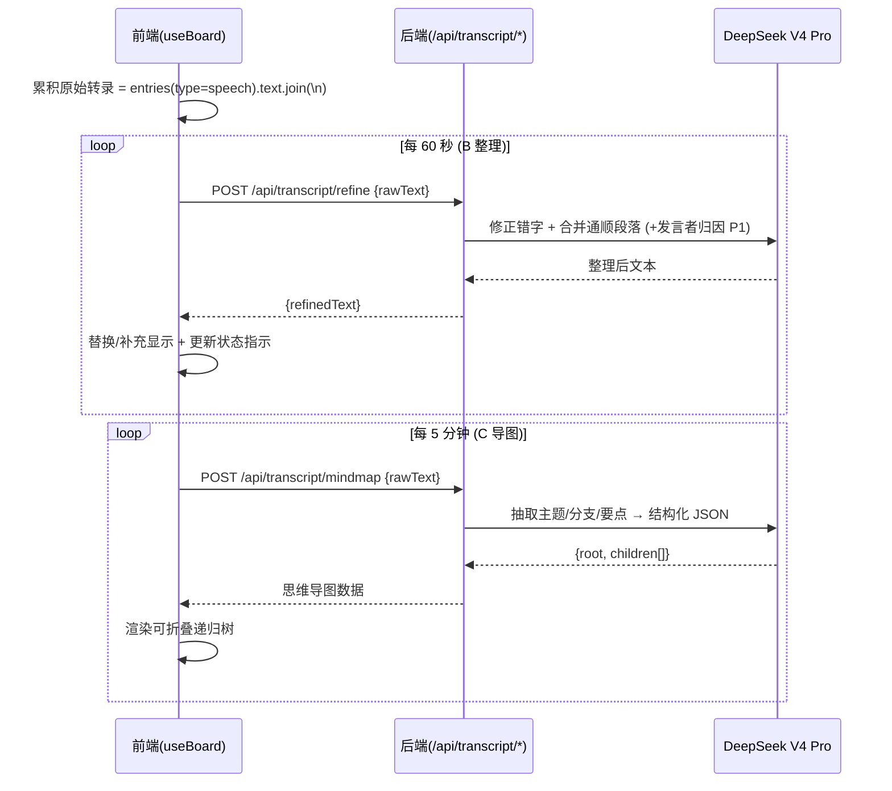
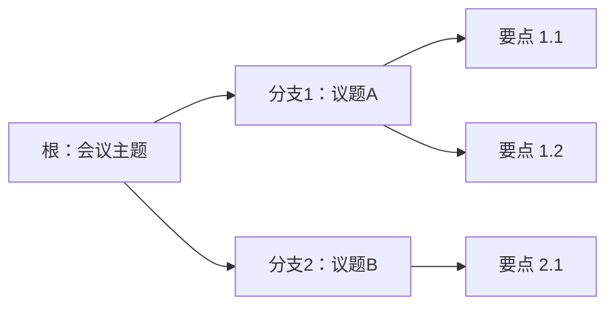

# PRD · 实时转录增强（段落化 + LLM 整理 + 思维导图）

> 简单 PRD（不含竞品分析）。面向「AI 大咖会议私董会」已上线项目，对**实时转录体验**做三大增强。

## 1. 项目信息

| 项 | 内容 |
| --- | --- |
| Language | 中文（zh-CN） |
| Programming Language | 前端 React 19 + Vite 8 + TypeScript 6.0（strict）；后端 Node ESM（`server/*.mjs`）；样式为项目既有 CSS 变量（非 MUI，避免引入新 UI 框架） |
| Project Name | `live_transcript_mindmap` |
| 部署现状 | https://meeting.weispace.com.cn/（Caddy 反代 + systemd `aiboard.service`，重启自拉起） |
| 已有链路 | `src/lib/transcription.ts`（`TranscriptionController`，输出 `onTranscript(text, final)` / `onInterim(text)`）→ `src/hooks/useBoard.ts`（持有 `entries`、`interim`、`addHuman`）→ `src/components/TranscriptPanel.tsx`（渲染 `.line` / `.line.interim`）→ `src/components/BoardRoom.tsx`（组装界面） |
| LLM 复用 | `server/llm-router.mjs`：`deepseekKey()`（DeepSeek V4 Pro，用于大咖发言）+ `streamOpenAiCompatible({baseUrl, apiKey, model, messages, signal})`（可收集 token 做非流式批量调用） |

### 原始需求复述
对实时转录体验做三大增强（参考「飞书妙记」）：
- **A. 转录显示重做（纯前端）**：由「一行行碎片文字 + 大字体」改为**段落式**展示，按说话轮次/停顿聚合为可读段落；缩小字体、紧凑行距，提升单屏信息量；实时 interim 在段末以浅色/斜体「正在识别…」提示。
- **B. 周期性 LLM 整理（每 60 秒）**：后端新接口接收累积原始转录 → 调 DeepSeek V4 Pro 修正错别字、合并为通顺连贯段落（上下文足以判断发言者时尝试归因）→ 返回整理文本；前端每 60 秒发送一次，替换/补充显示（整理版与原稿可并存或切换）。
- **C. 实时思维导图（每 5 分钟）**：后端新接口接收累积转录 → 调 LLM 抽取主题/分支/要点，输出**结构化思维导图 JSON**（根节点 + 多级子节点，含层级与简要文字）；前端每 5 分钟调用一次，渲染**可折叠**思维导图（可滚动/缩放）；可视化倾向轻量（HTML/SVG 递归树或 markmap，需评估包体积）。

---

## 2. 产品目标

提升企业高管在「AI 大咖会议私董会」中的**实时信息吸收效率**：通过将碎片化的浏览器实时转写重构为段落式、由 LLM 周期性整理为通顺纪要、并自动提炼为可折叠的思维导图，让用户在会议进行中即可用更少滚动/更高密度掌握讨论脉络与关键要点，降低认知负担，同时为会后复盘提供结构化素材——全程不阻塞现有 22 位大咖的实时发言链路。

---

## 3. 用户故事

1. **作为企业高管**，我希望实时转写以段落而非碎片行的形式呈现，以便在一屏内快速读懂当前讨论、减少滚动，专注听取大咖意见。
2. **作为会议主持人**，我希望系统每约 1 分钟自动把口语化、带错字的转写整理成通顺段落，以便我随时回看「刚刚在讨论什么」而无需逐字辨认草稿。
3. **作为复盘者**，我希望会议进行中自动生成可折叠的思维导图，以便我一眼把握会议主题、分支议题与关键要点，并能在会后顺着结构回忆细节。
4. **作为重度使用者**，我希望整理版与原稿可切换/并存（P1），以便在校对准确性与阅读流畅度之间自行取舍。
5. **作为移动/小屏用户**，我希望思维导图可折叠、可缩放（P1），以便在有限空间内聚焦当前最关心的分支，不被庞大结构淹没。

---

## 4. 需求池（P0 / P1 / P2）

> 优先级：P0 必须（MVP 核心链路）｜P1 应有（体验增强）｜P2 可选（锦上添花）
> 数据来源约定：B/C 接口的前端输入「累积原始转录」= `entries.filter(e => e.type === 'speech').map(e => e.text).join('\n')`（沿用 `useBoard.maybeAuto` 既有拼接方式）。

### P0（必做）

| 编号 | 需求 | 说明 / 验收 |
| --- | --- | --- |
| **A1** | 段落式聚合渲染 | 将 `entries`（type=speech）按「新 final 段 vs 续写」「停顿/轮次切换」聚合成段落块；同一次连续发言合并为一段。单段内保留时间序。 |
| **A2** | 信息密度优化 | 正文 14px、行距 1.45、段间距 8px（相对当前 ~18–20px 大字体明显收紧）；单屏（~720px 高）可容纳约 30+ 行等效文本。提供紧凑滚动。 |
| **A3** | 实时 interim 提示 | `interim` 在当前段落**末尾**以浅灰斜体显示「正在识别…」+ 候选词；interim 消失/转为 final 时归并入段落。 |
| **B1** | 后端整理接口 | 新增 `POST /api/transcript/refine`：入参 `{ rawText: string }` → 调 `deepseekKey()` + `streamOpenAiCompatible`（收集全文）→ 返回 `{ refinedText: string }`。修正错别字、合并通顺连贯段落；无发言者上下文时仅文本润色。 |
| **B2** | 前端周期调用 B1 | 前端每 **60 秒**将累积原始转录发往 B1；拿到 `refinedText` 后**替换/补充**显示；并显示「整理中… / 最近整理于 HH:MM」状态指示。 |
| **C1** | 后端思维导图接口 | 新增 `POST /api/transcript/mindmap`：入参 `{ rawText: string }` → 调 DeepSeek V4 Pro → 返回结构化 JSON：`{ root: {title, children:[{title, children:[...]}]} }`，含层级与简要文字（建议 ≤4 层）。 |
| **C2** | 前端周期调用 C1 + 基础渲染 | 前端每 **5 分钟**调用 C1；渲染**基础可滚动**思维导图（递归树，节点可展开/收起的最小可用版）。 |

### P1（应有）

| 编号 | 需求 | 说明 / 验收 |
| --- | --- | --- |
| **B3** | 按发言者归因 | B1 在上下文足以判断发言者时，将段落按发言者归因（如「张总：…」）；不足时退化为纯文本润色。 |
| **B4** | 整理版 / 原稿切换 UI | 转录区提供「原稿 / 整理版」视图切换（或并列双栏），用户可比对与回退。 |
| **C3** | 思维导图折叠交互 | 节点点击展开/收起子节点；提供「展开全部 / 折叠全部」控制。 |
| **C4** | 思维导图缩放 | 面板支持缩放（滚轮或按钮），适配长/宽结构。 |

### P2（可选）

| 编号 | 需求 | 说明 / 验收 |
| --- | --- | --- |
| **P2-1** | 导出 | 导出思维导图（PNG/SVG/JSON）与导出整理后转录（Markdown/纯文本）。 |
| **P2-2** | 节点手动编辑 | 思维导图节点支持手动拖拽/改名/增删（与自动生成结果合并展示）。 |
| **P2-3** | 错误降级 UI | LLM 整理/导图失败（超时、限流、密钥缺失）时，给出明确降级展示（保留原稿、提示「整理暂不可用」），不白屏。 |

---

## 5. UI 设计稿

### 5.1 会议界面新布局（mermaid）

### 5.2 周期调用数据流（mermaid）

### 5.3 思维导图数据结构（mermaid）

### 5.4 信息密度改进点（对比）

| 维度 | 当前 | 目标（A2） |
| --- | --- | --- |
| 正文字号 | ~18–20px（大字体） | 14px |
| 行距 | 宽松（~1.8） | 1.45 |
| 段间距 | 无（逐行） | 8px |
| 组织单位 | 单行碎片 `.line` | 段落块（按轮次/停顿聚合） |
| 单屏等效行数 | 低（约 10–15 行） | 高（约 30+ 行等效文本） |
| interim 呈现 | 独立一行高亮 | 段末浅灰斜体「正在识别…」 |

### 5.5 交互要点
- **转录区**：段落块自上而下流；新段落入屏自动滚动到底；interim 仅附在当前段末，不单独成块。
- **思维导图面板**：右侧固定栏；基础版（P0）可滚动 + 节点可折叠；P1 增加缩放与展开/折叠全部。
- **状态指示**：转录区状态条显示「整理中…」（请求进行中）与「最近整理于 HH:MM」（上次成功），让用户感知 LLM 节奏而不打断阅读。
- **降级**：B/C 失败时状态条提示「整理/导图暂不可用」，转录区回退为原稿段落（P2 细化 UI）。

---

## 6. 待确认问题（需用户 / 架构师拍板）

1. **LLM 整理失败降级策略**：超时 / 限流 / 密钥缺失时，是「保留原稿不动」「整段重试一次」还是「局部降级」？降级 UI 属 P2，但策略需先定。
2. **思维导图节点上限**：层级深度（建议 ≤4 层？）与每层子节点数是否设上限，防止超长/超宽导致渲染与可读性恶化？
3. **是否允许手动编辑节点**：拖拽/改名/增删（P2-2）是否本期做？若做，自动生成与手动修改如何合并/冲突处理？
4. **整理接口入参是否带发言者信息**：当前转录链路仅 `type:'speech'`、无发言者字段；若要做 P1 归因（B3），前端/后端需先建立发言者识别机制（本身是个更大的需求），本期是否仅做纯文本润色、把归因留到后续？
5. **可视化方案与包体积**：采用 markmap 还是自研 HTML/SVG 递归树？是否接受新增前端依赖（需评估 gzip 体积与离线可用性）？
6. **调用频率与成本**：每 60s 整理 + 每 5min 导图对 DeepSeek V4 Pro 的调用量与费用是否可接受？是否需要限流、合并（如整理与导图共用一次请求）、或会议空闲时暂停？
7. **阿里云 ASR 模式下的数据来源**：`aliyun` 模式后端已落库完整转录；B/C 接口是否改为后端直接读落库文本（省去前端每次重发），还是维持「前端累积发送」统一方案？
8. **整理结果是否写回后端 / 影响大咖自动发言**：整理文本是否持久化？是否作为 `maybeAuto` 自动发言的上下文（当前用原始 `entries`）？

---

## 7. 范围与边界（明确不做）

- 不改动现有 22 位大咖发言链路（`speakRequest` / `parseSpeakStream` / `role-service`）。
- 不引入新的前端 UI 框架（保持既有 CSS 变量体系）。
- 不做流式逐字整理（B/C 均为批量请求，C 为结构化 JSON）。
- 竞品分析不在本期范围（用户已确认参考飞书妙记，无需展开）。
