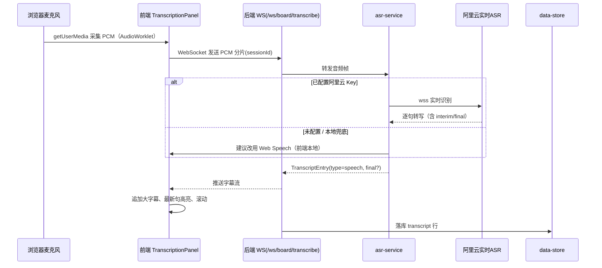
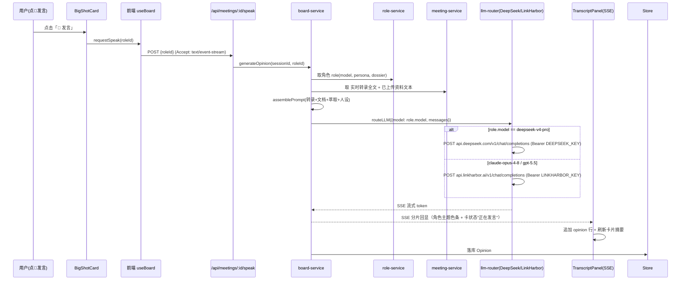

# AI 大咖会议私董会 · 系统架构设计

> 文档角色：架构师·高见远
> 版本：v1.0（架构设计稿）
> 日期：2026-07-09
> 范围：系统架构 + 任务分解（仅设计，不含实现代码）
> 产品定名：**AI 大咖会议私董会**

---

## 〇、总览（Architect's Brief）

把公司高管的会议室变成"虚拟董事会现场"：浏览器采集麦克风 → 实时语音转文字（大字幕流）→ 一排"大咖"角色（2 个大模型角色 Claude / GPT-5.5 + 20 位真实企业家/投资人）基于实时转录与项目简报，自动或手动给出董事式意见。

**技术底座决策**：以已验证的 `fde-demo`（React+Vite 前端 + Node/Express 风格 ESM 后端，已含 `asr-service` / `llm-router` / 角色内核 / 转写内核）为 fork 源，裁剪答辩专用页，复用其转写与 LLM 路由内核，改造为私董会语义。新建工程目录：**`D:\works\workbuddy\meetingOS\ai-board\`**。

**三大已锁定事实（不可偏离）**
1. 界面上下分栏：上 65% 实时字幕流，下 35% 大咖意见反馈条（顺序 Claude → GPT-5.5 → 20 位大咖）。
2. 大模型接入三通道，密钥全走环境变量、禁止硬编码/打印：
   - 20 位大咖 → **DeepSeek V4 Pro**（`https://api.deepseek.com/v1/chat/completions`，model=`deepseek-v4-pro`，取 `message.content`）。
   - Claude / GPT → **LinkHarbor 网关**（`https://api.linkharbor.ai/v1`，OpenAI 兼容），model=`claude-opus-4-8` / `gpt-5.5`。
3. 语音识别主链路阿里云实时 ASR（待用户给 Key）；浏览器 Web Speech API 作为本地兜底。

---

## 一、实现方案 + 框架选型

### 1.1 前端
| 项 | 选型 | 说明 |
|---|---|---|
| 语言/框架 | **React 19 + TypeScript + Vite 8** | 沿用 fde-demo，零额外学习成本 |
| 样式 | **Tailwind CSS**（+ 少量 CSS 变量玻璃拟态） | 沿用原型 `prototype/index.html` 的蓝色科技感、玻璃拟态、上下分栏视觉 |
| 状态 | React 内置 `useState`/`useReducer` + 自写 hooks | 会议态体量小，不需要 Redux |
| 实时通道 | 浏览器原生 `WebSocket`（字幕流）+ `fetch` + `EventSource`/`ReadableStream`（发言 SSE） | 见 §七 共享协议 |
| 麦克风 | `getUserMedia` + `AudioWorklet`/ScriptProcessor 采集 PCM → WS 上传；`AudioContext` 做音量条 | 需 HTTPS 或 localhost 安全上下文 |

### 1.2 后端
| 项 | 选型 | 说明 |
|---|---|---|
| 运行时 | **Node.js ESM（`.mjs`）** | 沿用 fde-demo `server/*.mjs` |
| HTTP 服务 | Node 内置 `http` + `ws`（见 fde-demo `api-server.mjs`） | 单进程同时托管 REST + WebSocket |
| ASR | 复用 `asr-service.mjs`（已支持 aliyun WebSocket / openai-compatible）+ Web Speech 兜底协商 | 阿里云端点 `wss://dashscope.aliyuncs.com/api-ws/v1/inference` |
| LLM 路由 | 新建 `llm-router.mjs` 改造版：按角色 `model` 字段分流到 DeepSeek / LinkHarbor，保留本地规则兜底 | fde-demo 原 `routeLLM` 仅单通道，需扩展为双网关 |
| 持久化 | **SQLite**（复用 `data-store.mjs`） | 会议、意见、纪要落盘，支持导出 |
| 资料解析 | `pdf-parse` + `mammoth` + 纯文本/Markdown 直读 | 见 §六 |

### 1.3 目录结构（新建 `ai-board/`）
```
ai-board/
├── index.html                      # Vite 入口
├── package.json                    # 依赖与脚本（fork 自 fde-demo 并增项）
├── vite.config.ts
├── tsconfig.app.json / tsconfig.json / tsconfig.node.json
├── .env.example                    # 环境变量模板（提交）
├── .gitignore                      # 忽略 .env / node_modules / data/*.sqlite
├── README.md                       # 启动说明（fork 自 fde-demo 并改写）
├── public/
│   └── avatars/                    # 复制自 meetingOS/assets/avatars（20 张真人头像）
├── data/
│   ├── board.sqlite                # 会议/意见/纪要持久化（运行时生成，gitignore）
│   └── store.json                  # 角色与会议种子（首次启动写入）
├── dossiers/                       # 20 位大咖萃取内容（待 clawharbor 仓库，见 §八）
│   ├── steve_jobs.md
│   ├── elon_musk.md
│   └── ...（每位一个）
├── server/
│   ├── api-server.mjs              # HTTP + WS 主服务（fork+改造）
│   ├── asr-service.mjs             # 语音识别（阿里云 + 兜底，fork）
│   ├── llm-router.mjs              # LLM 路由（DeepSeek/LinkHarbor 双网关，改造）
│   ├── board-service.mjs           # 私董会核心：拼装 prompt + 发言生成 + 自动发言
│   ├── role-service.mjs            # 角色 CRUD + 萃取内容加载（fork 自 Defense 角色体系）
│   ├── material-service.mjs        # 资料上传解析（pdf/docx/txt/md，fork）
│   ├── meeting-service.mjs         # 会议状态/简报/纪要管理（新增）
│   └── data-store.mjs              # SQLite 封装（fork）
└── src/
    ├── main.tsx
    ├── App.tsx                     # 路由：准备页 / 会议页
    ├── index.css / App.css         # 玻璃拟态主题（fork 原型）
    ├── types.ts                    # 前后端共享类型（Role/TranscriptEntry/Opinion/MeetingDoc）
    ├── lib/
    │   ├── api.ts                  # 前端接口层（fetch + WS URL 构造）
    │   ├── transcription.ts        # 浏览器采集 + 音量监测 + Web Speech 兜底
    │   └── sse.ts                  # SSE/流式响应解析工具
    ├── hooks/
    │   ├── useMeeting.ts           # 会议状态/简报/资料
    │   └── useBoard.ts             # 大咖列表/发言状态
    └── components/
        ├── MeetingPrep.tsx         # P1 会议准备页（标题编辑 + 选参会大咖 + 资料上传）
        ├── BoardRoom.tsx           # P2 会议主页（上下分栏容器）
        ├── TranscriptPanel.tsx     # 上半区字幕流
        ├── BriefPill.tsx           # 顶部可折叠会议标题/简报胶囊
        ├── MicControls.tsx         # 麦克风状态 + 音量条 + 开始/停止
        ├── BigShotBar.tsx          # 下半区大咖条容器
        ├── BigShotCard.tsx         # 单张大咖卡（头像/状态/摘要/发言按钮）
        ├── NewBigShotModal.tsx     # + 新建大咖弹窗
        └── MaterialUpload.tsx      # 会议资料上传入口
```

> **fork 策略**：`git clone` / 复制 `fde-demo` 到 `ai-board/`，删除答辩专用页面（`Defense.tsx`、`Assessment.tsx`、`Certificate.tsx`、`Courses.tsx`、`Login.tsx`、`Dashboard.tsx` 等评估体系），保留 `asr-service.mjs`、`llm-router.mjs`、`material-service.mjs`、`data-store.mjs`、`transcription.ts`、`api.ts` 内核。新增 `board-service.mjs` / `meeting-service.mjs` / `role-service.mjs` 承载私董会语义。

---

## 二、文件列表及相对路径（职责表）

| 路径 | 类型 | 职责 |
|---|---|---|
| `src/App.tsx` | 前端 | 页面路由：准备态 → 会议态 |
| `src/types.ts` | 共享 | Role / TranscriptEntry / Opinion / MeetingDoc / UploadResult 类型定义（前后端共用契约） |
| `src/lib/transcription.ts` | 前端 | `getUserMedia` 采集 PCM、音量监测 `AudioLevelMonitor`、`BrowserSpeechTranscriptionProvider`（Web Speech 兜底） |
| `src/lib/api.ts` | 前端 | 构造 WS URL（`boardTranscribeWsUrl`）、`startMeeting`/`uploadMaterial`/`requestSpeak` 等 REST 封装 |
| `src/lib/sse.ts` | 前端 | 解析后端 `text/event-stream` 流式意见分片 |
| `src/components/BoardRoom.tsx` | 前端 | 上下分栏布局（65% / 35%），组合各子组件 |
| `src/components/TranscriptPanel.tsx` | 前端 | 字幕流滚动、最新句高亮、角色发言以主题色条追加 |
| `src/components/BigShotBar.tsx` + `BigShotCard.tsx` | 前端 | 大咖横向条 + 单卡（圆头像/姓名头衔/状态/摘要/💬发言） |
| `src/components/MeetingPrep.tsx` | 前端 | 自定义会议标题、选参会大咖、上传资料 |
| `src/components/NewBigShotModal.tsx` | 前端 | 临时新建大咖（名称/头衔/关注点/头像URL/主题色） |
| `server/api-server.mjs` | 后端 | 主服务：挂载 REST 路由 + `/ws/board/transcribe` + 发言 SSE 端点 |
| `server/asr-service.mjs` | 后端 | 转发 PCM 到阿里云实时识别 / OpenAI-compatible；导出 `asrRuntimeConfig` / `transcribeAudio` |
| `server/llm-router.mjs` | 后端 | `routeLLM({model, messages})`：按 model 分流 DeepSeek / LinkHarbor；本地兜底 |
| `server/board-service.mjs` | 后端 | **核心**：`assemblePrompt()`（转录+文档+萃取）、`generateOpinion()`（流式）、`autoPickSpeakers()`（自动发言） |
| `server/role-service.mjs` | 后端 | 角色库加载（含 Claude/GPT 特殊角色）、CRUD、萃取内容读取 |
| `server/meeting-service.mjs` | 后端 | 会议创建/简报更新/资料登记/纪要汇总导出 |
| `server/material-service.mjs` | 后端 | `extractMaterialTextFromFile()`：pdf/docx/txt/md 文本抽取 |
| `server/data-store.mjs` | 后端 | SQLite 读写封装 |
| `data/store.json` | 数据 | 角色种子（fork 自 `大咖角色库.json` + Claude/GPT 特殊角色） |
| `dossiers/<id>.md` | 数据 | 20 位大咖萃取内容（思想体系/决策框架/代表观点/金句），**待接入** |
| `.env.example` | 配置 | 环境变量模板（见 §七） |

---

## 三、数据结构与接口（JSON Schema）

> 前后端以 `src/types.ts` 为唯一契约源，下方为等价 JSON Schema 描述。

### 3.1 BigShot / Role（含 model 路由字段）
```json
{
  "$schema": "角色定义 / BigShot Role",
  "type": "object",
  "required": ["id","cn","title","color","model","provider"],
  "properties": {
    "id":        { "type": "string", "description": "唯一标识，如 steve_jobs / claude / gpt55" },
    "en":        { "type": "string", "description": "英文名" },
    "cn":        { "type": "string", "description": "中文名" },
    "title":     { "type": "string", "description": "头衔/定位，如 '产品极致主义者'" },
    "color":     { "type": "string", "description": "主题色 HEX，发言色条用" },
    "initial":   { "type": "string", "description": "首字母占位（无头像时回退）" },
    "avatar":    { "type": "string", "description": "头像相对/绝对路径或 URL" },
    "avatarOk":  { "type": "boolean", "description": "头像是否可用" },
    "persona":   { "type": "string", "description": "人设草案（基于公开认知，可编辑）" },
    "focus":     { "type": "array", "items": { "type": "string" }, "description": "关注点关键词，自动发言相关性命中用" },
    "model":     { "type": "string", "enum": ["deepseek-v4-pro","claude-opus-4-8","gpt-5.5"], "description": "路由键，决定走哪个网关" },
    "provider":  { "type": "string", "enum": ["deepseek","linkharbor"], "description": "网关归属" },
    "dossier":   { "type": "string", "description": "萃取内容引用（dossiers/<id>.md 路径或内联），待接入" },
    "preset":    { "type": "boolean", "description": "是否预置 20 位之一" },
    "custom":    { "type": "boolean", "description": "是否为会议内/库内自定义大咖" },
    "order":     { "type": "integer", "description": "在底部大咖条中的排序（Claude=0,GPT=1,大咖=2..21）" }
  },
  "examples": [
    { "id":"claude","cn":"Claude","title":"Anthropic 大模型","color":"#d97757","model":"claude-opus-4-8","provider":"linkharbor","preset":true,"order":0 },
    { "id":"gpt55","cn":"GPT-5.5","title":"OpenAI 大模型","color":"#10a37f","model":"gpt-5.5","provider":"linkharbor","preset":true,"order":1 },
    { "id":"steve_jobs","cn":"乔布斯","title":"产品极致主义者","color":"#e8703a","model":"deepseek-v4-pro","provider":"deepseek","preset":true,"order":2 }
  ]
}
```

### 3.2 TranscriptEntry（字幕流条目）
```json
{
  "$schema": "字幕流/发言条目",
  "type": "object",
  "required": ["id","sessionId","text","type","ts"],
  "properties": {
    "id":        { "type": "string" },
    "sessionId": { "type": "string", "description": "会议会话 ID" },
    "text":      { "type": "string", "description": "一句转写文本 或 一条大咖意见" },
    "type":      { "type": "string", "enum": ["speech","opinion"], "description": "speech=人类转写, opinion=大咖发言" },
    "roleId":    { "type": "string", "description": "type=opinion 时为发言角色 id" },
    "speaker":   { "type": "string", "description": "展示名（人类=空/主持人，大咖=中文名）" },
    "color":     { "type": "string", "description": "opinion 时取角色主题色，用于左侧色条" },
    "final":     { "type": "boolean", "description": "转写是否终稿（流式 interim 时为 false）" },
    "ts":        { "type": "string", "format": "date-time" }
  }
}
```

### 3.3 MeetingDoc（上传资料）
```json
{
  "$schema": "会议资料文档",
  "type": "object",
  "required": ["id","name","parsedText"],
  "properties": {
    "id":         { "type": "string" },
    "sessionId":  { "type": "string" },
    "name":       { "type": "string", "description": "原文件名" },
    "type":       { "type": "string", "enum": ["pdf","docx","txt","md"] },
    "parsedText": { "type": "string", "description": "解析后的纯文本，拼入发言 prompt" },
    "sizeBytes":  { "type": "integer" },
    "addedAt":    { "type": "string", "format": "date-time" }
  }
}
```

### 3.4 Opinion（一条意见记录 / 落库）
```json
{
  "$schema": "大咖意见落库记录",
  "type": "object",
  "required": ["id","sessionId","roleId","text","ts"],
  "properties": {
    "id":        { "type": "string" },
    "sessionId": { "type": "string" },
    "roleId":    { "type": "string" },
    "text":      { "type": "string" },
    "severity":  { "type": "string", "enum": ["info","warn","risk"], "description": "自动发言时评估的严重度" },
    "trigger":   { "type": "string", "enum": ["manual","auto"], "description": "手动点发言 / 自动触发" },
    "ts":        { "type": "string", "format": "date-time" }
  }
}
```

### 3.5 UploadParseResult（解析接口返回）
```json
{
  "$schema": "资料解析结果",
  "type": "object",
  "required": ["ok","id","name","parsedText"],
  "properties": {
    "ok":         { "type": "boolean" },
    "id":         { "type": "string" },
    "name":       { "type": "string" },
    "type":       { "type": "string" },
    "parsedText": { "type": "string" },
    "error":      { "type": "string", "description": "失败时原因" }
  }
}
```

### 3.6 REST 接口一览
| Method | Path | 说明 | 请求 | 响应 |
|---|---|---|---|---|
| POST | `/api/meetings` | 创建会议（标题+简报） | `{title, brief}` | `Meeting` |
| GET | `/api/meetings/:id` | 取会议 + 参会大咖 + 资料列表 | — | `Meeting` |
| PATCH | `/api/meetings/:id` | 更新标题/简报 | `{title?, brief?}` | `Meeting` |
| POST | `/api/meetings/:id/roles` | 加入参会大咖 / 新建自定义大咖 | `Role`（部分） | `Role` |
| DELETE | `/api/meetings/:id/roles/:roleId` | 移除大咖 | — | `{ok}` |
| POST | `/api/meetings/:id/materials` | 上传资料（multipart） | file | `UploadParseResult` |
| GET | `/api/meetings/:id/materials` | 资料列表 | — | `MeetingDoc[]` |
| POST | `/api/meetings/:id/speak` | **手动发言**：请求某角色表态 | `{roleId}` | SSE 流（`text/event-stream`，分片回显意见） |
| GET | `/api/meetings/:id/opinions` | 历史意见 | — | `Opinion[]` |
| GET | `/api/meetings/:id/export` | 导出纪要（md） | — | Markdown 文本 |

---

## 四、程序调用流程（Mermaid 时序图）

### 4.1 麦克风 → ASR → 字幕流（实时转写链路）


### 4.2 点「发言」→ 后端组装 prompt → LLM → 流式意见


### 4.3 自动发言（P3，基于相关性命中，拓扑同上）
`board-service.autoPickSpeakers()`：每累积 ~60s 或检测到 `focus` 关键词命中，选 1–2 位最相关大咖，复用 4.2 的生成链路，`trigger=auto`。

---

## 五、任务列表（按实现顺序，含依赖）

> 依赖关系用 `→` 表示"前置依赖"。阶段从 P0 到 P6。

| ID | 阶段 | 任务 | 依赖 | 产出/验收 |
|---|---|---|---|---|
| T0 | P0 | fork fde-demo → `ai-board/`，清理答辩专用页，保留 asr/llm/material/data 内核；建立 §一目录结构与 `.env.example`/`.gitignore` | — | 能 `npm i && npm run dev` 启动空壳 |
| T1 | P0 | 角色体系改造：在 `role-service` 注入 20 位大咖（fork 自 `大咖角色库.json`）+ 2 个特殊角色 Claude(`claude-opus-4-8`)/GPT(`gpt-5.5`)，加 `model`/`provider`/`order` 字段；复制头像到 `public/avatars/` | T0 | 角色 API 返回 22 位且顺序正确 |
| T2 | P0 | `llm-router` 双网关改造：`routeLLM` 按 `model` 分流 DeepSeek / LinkHarbor，保留本地规则兜底；密钥从 env 读 | T0 | 单测：mock 三模型路由正确 |
| T3 | P1 | 会议准备页 `MeetingPrep`：自定义会议标题（可编辑）、选参会大咖、`MaterialUpload` 资料上传（调 material-service） | T1 | 创建会议 + 上传资料成功 |
| T4 | P1 | `meeting-service`：会议/简报 CRUD、资料登记、与角色关联 | T1,T3 | REST 可用 |
| T5 | P2 | 上下分栏布局 `BoardRoom`（65/35）+ 玻璃拟态主题（fork 原型） | T0 | 布局与视觉对齐原型 |
| T6 | P2 | 上半区：字幕流 `TranscriptPanel` + `BriefPill`（可折叠标题/简报）+ `MicControls`（麦克风状态/音量条/开始停止） | T5 | 本地 Web Speech 兜底可滚动字幕 |
| T7 | P2 | 下半区：大咖条 `BigShotBar` + `BigShotCard`（头像/姓名头衔/状态/摘要/💬发言）+ `NewBigShotModal`（临时新建） | T1,T5 | 22 卡含新建入口，点发言高亮 |
| T8 | P2 | 发言链路前端：`useBoard` + `api.ts` 调 `/speak` SSE，回显意见到字幕流（角色色条） | T7,T4 | 点发言 → 字幕流出现该角色意见 |
| T9 | P3 | `board-service` 核心：`assemblePrompt`（转录+文档+萃取+人设）、`generateOpinion` 流式、自动发言 `autoPickSpeakers` | T2,T4 | 手动+自动发言打通（先用本地兜底） |
| T10 | P3 | 自动发言 UI 指示（卡"正在发言"状态机、3s 自动回旁听等，对齐原型逻辑） | T7,T9 | 自动插话可见 |
| T11 | P4 | **大咖萃取内容接入（待 clawharbor 仓库）**：拉取 20 位萃取 → `dossiers/<id>.md` → `assemblePrompt` 引用 `dossier` 字段提升意见质量 | T9 | 意见引用萃取内容（占位先跑通） |
| T12 | P5 | **阿里云 ASR 接入（待 Key）**：配 `FDE_ASR_PROVIDER=aliyun` + AppKey/APIKey/区域，`transcription.ts` 走 WS 上传 PCM 而非 Web Speech | T0,T6 | 真实收音转写（浏览器 WS 链路） |
| T13 | P6 | 纪要沉淀：汇总 Opinion → 按严重度排序 → 导出 md；`/export` 端点 | T4,T9 | 可导出纪要 |
| T14 | P6 | 质检：接口联调、SSE/WS 断线重连、Key 缺失兜底不白屏、麦克风安全上下文检查、依赖审计 | T8,T12,T13 | 验收通过 |

**关键路径**：T0 → T1 → T2 → T9 → T11/T12 ；P1（T3/T4）与 P2（T5-T8）可并行起步，但最终由 T9 收口。

---

## 六、依赖包列表

| 包 | 类型 | 用途 | 备注 |
|---|---|---|---|
| `react` / `react-dom` | 前端 | UI 框架 | 沿用 fde-demo React 19 |
| `vite` + `@vitejs/plugin-react` | 前端 | 构建/DevServer | 沿用 |
| `typescript` + `@types/*` | 前端 | 类型 | 沿用 |
| `tailwindcss` | 前端 | 样式（玻璃拟态/主题） | **新增**（原型用原生 CSS，正规模板化） |
| `lucide-react` / `@ant-design/icons` | 前端 | 图标（麦克风/发言等） | 沿用 fde-demo |
| `clsx` | 前端 | 条件类名 | 沿用 |
| `ws` | 后端 | WebSocket（ASR 转发 + 前端字幕流） | 沿用 |
| `express` *可选* | 后端 | 若不愿用 Node 原生 http 承载 REST | fde-demo 用原生 http，保持原生以减依赖 |
| `dotenv` | 后端/前端 | 载入 `.env`（DEEPSEEK_KEY / LINKHARBOR_KEY / ASR_*） | **新增**（fde-demo 直接读 process.env，统一加 dotenv 更稳） |
| `pdf-parse` | 后端 | 解析 PDF 会议资料 | 沿用 material-service |
| `mammoth` | 后端 | 解析 DOCX 会议资料 | 沿用 material-service |
| `better-sqlite3` / `node:sqlite` | 后端 | 会议/意见持久化 | 沿用 data-store（fde-demo 已有 SQLite 封装） |
| `multer` *可选* | 后端 | 资料上传 multipart 解析 | 视 material-service 现状决定 |
| `node-fetch` *可选* | 后端 | LLM 网关调用（Node18+ 可用全局 fetch） | 优先用全局 fetch |

> **密钥约束**（跨任务）：所有 Key 仅经 `process.env` 注入，`.env` 入 `.gitignore`；禁止出现在代码、日志、报错回显中。

---

## 七、共享知识（跨文件约定）

### 7.1 环境变量命名（`.env.example`）
```bash
# —— DeepSeek（20 位大咖意见）——
DEEPSEEK_KEY=sk-xxxx
DEEPSEEK_BASE_URL=https://api.deepseek.com/v1
DEEPSEEK_MODEL=deepseek-v4-pro

# —— LinkHarbor 网关（Claude / GPT）——
LINKHARBOR_KEY=sk-xxxx
LINKHARBOR_BASE_URL=https://api.linkharbor.ai/v1
LINKHARBOR_CLAUDE_MODEL=claude-opus-4-8
LINKHARBOR_GPT_MODEL=gpt-5.5

# —— 阿里云实时 ASR（待用户给 Key）——
ALIYUN_ASR_ENABLED=false          # 给 Key 后改 true
ALIYUN_ASR_API_KEY=
ALIYUN_ASR_APP_KEY=
ALIYUN_ASR_REGION=cn-shanghai
ALIYUN_ASR_WS_URL=wss://dashscope.aliyuncs.com/api-ws/v1/inference

# —— 服务 ——
PORT=4317
NODE_ENV=development
```

### 7.2 model 路由约定（唯一真理）
| 角色类别 | `model` 值 | `provider` | 网关/端点 |
|---|---|---|---|
| 20 位大咖 | `deepseek-v4-pro` | `deepseek` | `DEEPSEEK_BASE_URL` + Bearer `DEEPSEEK_KEY` |
| Claude | `claude-opus-4-8` | `linkharbor` | `LINKHARBOR_BASE_URL` + Bearer `LINKHARBOR_KEY` |
| GPT-5.5 | `gpt-5.5` | `linkharbor` | 同上 |
| 兜底 | `local` | `local` | 本地规则生成（无 Key 不白屏） |

`routeLLM({model, messages})` 内部 `switch(model)`：命中 `deepseek-v4-pro` → DeepSeek 客户端；命中 `claude-opus-4-8`/`gpt-5.5` → LinkHarbor 客户端；默认 → 本地规则。

### 7.3 前端 WS / SSE 协议
- **字幕流 WS**：`ws(s)://<host>/ws/board/transcribe?sessionId=xxx`
  - 上行：PCM 二进制帧（`AudioWorklet` 采集，16bit/16k 或按 `ALIYUN_ASR_*` 采样率）。
  - 下行：JSON `{type:'transcript', entry: TranscriptEntry}`；`type:'error'`。
- **发言 SSE**：`POST /api/meetings/:id/speak` 时前端带 `Accept: text/event-stream`；后端以 `text/event-stream` 分片推送：
  - `event: start` → `{roleId, color}`（前端置卡"正在发言"）
  - `event: token` → `{delta}`（逐字追加到字幕流）
  - `event: end` → `{opinionId}`（卡摘要刷新、3s 后回旁听）
  - `event: error` → `{message}`（不暴露 Key）
- 前端 `sse.ts` 统一解析上述事件；WS 断线自动重连（指数退避）。

### 7.4 错误兜底约定
- LLM/ASR 未配置或调用失败 → 回退本地规则（确定性模板意见/模拟转写），界面不白屏，状态条提示"本地兜底模式"。
- 任何异常响应**不得**回显 Key 或内部栈；仅返回 `{ok:false, message:'服务暂不可用'}`。
- 头像加载失败（`onerror`）→ 首字母色块回退（复用原型 `avatar-fallback` 逻辑）。

### 7.5 角色排序约定
`order` 字段固定：Claude=0，GPT-5.5=1，20 位大咖=2..21，自定义大咖追加在末尾（位于"新建卡"之前）。大咖条始终 `Claude → GPT-5.5 → 20 位大咖 → 自定义 → +新建`。

---

## 八、待明确事项（开放问题 / 风险）

### 8.1 两项待接入输入（架构中先留接口/占位）
1. **clawharbor 的 GitHub 仓库地址** → 用于萃取 20 位大咖"几千字萃取内容"（思想体系/决策框架/代表观点/金句）。架构已预留 `dossiers/<id>.md` 与 Role.`dossier` 字段；T11 在拿到仓库后拉取并接入 `assemblePrompt`。**当前用 `persona`+`focus` 占位先跑通**。
2. **阿里云 ASR 的 APIKey + AppKey + 区域** → 真实实时语音。架构已预留 `ALIYUN_ASR_*` 变量与 `asr-service` 阿里云分支；T12 在拿到 Key 后切换，Web Speech 作为开发/预览兜底。

### 8.2 已识别风险与开放问题
| # | 风险/问题 | 影响 | 建议对策 |
|---|---|---|---|
| R1 | 麦克风需 HTTPS 或 localhost 安全上下文 | 部署到他机需证书 | 开发用 localhost；部署用反向代理（nginx）挂证书（fde-demo 已有 `nginx.conf` 参考） |
| R2 | 真实会议多人发言，v1 不做说话人分离（diarization） | 字幕流统一为"会议流"，不分人 | 明确 v1 单流；后续可接带分离的 ASR |
| R3 | DeepSeek `reasoning_content` 处理 | 需正确取 `message.content` 而非思维链 | `llm-router` 显式取 `choices[0].message.content`（架构已说明） |
| R4 | LinkHarbor 网关稳定性/速率 | 两个大模型角色可能限流 | SSE 超时与重试；失败回退本地规则 |
| R5 | 长会议转录/文档累计导致 prompt 超长 | token 成本/截断 | `assemblePrompt` 做最近 N 句转写 + 文档摘要截断（预留摘要策略） |
| R6 | 大咖意见"幻觉/不当表述" | 高管会议对内容敏感 | 系统提示约束"基于公开认知、以建议口吻、不编造数据"；纪要标注 AI 生成 |
| R7 | 自动发言频率失控刷屏 | 干扰会议 | 节流（~60s/话题切换）、单时刻仅 1-2 位、可一键静音自动发言 |
| R8 | 萃取内容版权/准确性 | clawharbor 仓库内容合规 | 仅作"思想风格模拟"，明确非本人真实发言；拿到仓库后做合规评估 |
| R9 | 自定义大咖持久化与导出 | 数据丢失 | SQLite 落库 + JSON 导入导出（沿用 fde-demo 机制） |

---

## 九、交付校验清单（Architect Sign-off）
- [x] 实现方案与框架选型（fork fde-demo，前后端技术栈与目录）
- [x] 文件列表及相对路径（前端组件/后端服务/配置/数据）
- [x] 数据结构与接口（Role/TranscriptEntry/MeetingDoc/Opinion/UploadResult JSON Schema + REST）
- [x] 调用流程时序图（ASR 链路 / 发言链路 / 自动发言）
- [x] 任务列表 P0–P6（含依赖与顺序）
- [x] 依赖包列表（用途标注）
- [x] 共享知识（env 命名 / SSE·WS 协议 / model 路由 / 错误兜底）
- [x] 待明确事项（两项待接入 + 9 项风险）
